# 06 — Data models

Source: SQLAlchemy 2 models in `backend/app/modules/<module>/models/*.py`, all inheriting `Base` from `backend/app/core/database.py`. Schema changes ship as Alembic migrations in `backend/alembic/versions/`. Database: PostgreSQL (asyncpg). This file was generated by introspecting the live model registry, so every table and column below exists in code.

**133 tables, 1669 columns.** Primary keys are UUIDs (`id`). Most tables carry `tenant_id` (FK `tenants.id`) plus `created_at`/`updated_at` timestamps.

## Entity relationship overview (core business tables)

Audit columns (`created_by`, `approved_by`, …) are omitted for readability.

```mermaid
erDiagram
    accounting_accounts ||--o{ accounting_expenses : "account_id"
    accounting_accounts ||--o{ accounting_transaction_lines : "account_id"
    accounting_accounts ||--o{ purchase_items : "expense_account_id"
    accounting_transactions ||--o{ accounting_expenses : "reversal_transaction_id"
    accounting_transactions ||--o{ accounting_transaction_lines : "transaction_id"
    accounting_transactions ||--o{ sales_order_payments : "accounting_transaction_id"
    branches ||--o{ accounting_expenses : "branch_id"
    branches ||--o{ accounting_transactions : "branch_id"
    branches ||--o{ approval_requests : "branch_id"
    branches ||--o{ inventory_warehouses : "branch_id"
    branches ||--o{ purchase_orders : "branch_id"
    branches ||--o{ sales_order_payments : "branch_id"
    branches ||--o{ sales_orders : "branch_id"
    branches ||--o{ sales_quotations : "branch_id"
    branches ||--o{ users : "branch_id"
    departments ||--o{ hr_employees : "department_id"
    departments ||--o{ users : "department_id"
    inventory_categories ||--o{ inventory_products : "category_id"
    inventory_product_variants ||--o{ inventory_stock_movements : "variant_id"
    inventory_product_variants ||--o{ purchase_items : "variant_id"
    inventory_product_variants ||--o{ sales_order_items : "variant_id"
    inventory_products ||--o{ inventory_product_variants : "product_id"
    inventory_products ||--o{ inventory_stock_movements : "product_id"
    inventory_products ||--o{ purchase_items : "product_id"
    inventory_products ||--o{ sales_order_items : "product_id"
    inventory_warehouses ||--o{ inventory_stock_movements : "warehouse_id"
    permissions ||--o{ role_permissions : "permission_id"
    purchase_orders ||--o{ accounting_transactions : "purchase_id"
    purchase_orders ||--o{ purchase_items : "purchase_order_id"
    roles ||--o{ role_permissions : "role_id"
    roles ||--o{ users : "role_id"
    sales_customers ||--o{ sales_order_payments : "customer_id"
    sales_customers ||--o{ sales_orders : "customer_id"
    sales_customers ||--o{ sales_quotations : "customer_id"
    sales_customers ||--o{ sales_returns : "customer_id"
    sales_orders ||--o{ accounting_expenses : "order_id"
    sales_orders ||--o{ accounting_transactions : "order_id"
    sales_orders ||--o{ sales_order_items : "order_id"
    sales_orders ||--o{ sales_order_payments : "order_id"
    sales_orders ||--o{ sales_quotations : "converted_order_id"
    sales_orders ||--o{ sales_returns : "order_id"
    sales_returns ||--o{ accounting_transactions : "return_id"
    tenants ||--o{ accounting_accounts : "tenant_id"
    tenants ||--o{ accounting_expenses : "tenant_id"
    tenants ||--o{ accounting_transactions : "tenant_id"
    tenants ||--o{ approval_requests : "tenant_id"
    tenants ||--o{ audit_logs : "tenant_id"
    tenants ||--o{ branches : "tenant_id"
    tenants ||--o{ departments : "tenant_id"
    tenants ||--o{ hr_employees : "tenant_id"
    tenants ||--o{ inventory_categories : "tenant_id"
    tenants ||--o{ inventory_products : "tenant_id"
    tenants ||--o{ inventory_stock_movements : "tenant_id"
    tenants ||--o{ inventory_warehouses : "tenant_id"
    tenants ||--o{ purchase_orders : "tenant_id"
    tenants ||--o{ roles : "tenant_id"
    tenants ||--o{ sales_customers : "tenant_id"
    tenants ||--o{ sales_order_payments : "tenant_id"
    tenants ||--o{ sales_orders : "tenant_id"
    tenants ||--o{ sales_quotations : "tenant_id"
    tenants ||--o{ sales_returns : "tenant_id"
    tenants ||--o{ users : "tenant_id"
    users ||--o{ approval_requests : "requested_by"
    users ||--o{ audit_logs : "actor_user_id"
    users ||--o{ inventory_stock_movements : "user_id"
    users ||--o{ inventory_warehouses : "manager_id"
    users ||--o{ sales_order_payments : "received_by"
    users ||--o{ sales_orders : "salesperson_id"
    users ||--o{ sales_quotations : "salesperson_id"
    users ||--o{ sales_returns : "processed_by"
```

## Design notes and issues found

- **Multi-tenancy by column, not schema.** Every business row has `tenant_id`; isolation is enforced in repositories/services (`BaseRepository.get_by_id_for_tenant`, `list_for_tenant`, …), not by Postgres row-level security. Child/line tables (e.g. `sales_order_items`, `purchase_items`, `accounting_transaction_lines`, `inventory_product_variants`, `role_permissions`) have **no `tenant_id`** and rely on their parent for scoping — safe only while every query goes through the parent.
- **Platform tables without `tenant_id` by design:** `tenants`, `permissions`, `currencies`, `billing_plans`/`billing_prices`/`billing_settings`, `feature_flags`, `platform_settings`, `marketing_*` (platform marketing, not tenant CRM), `support_*` channels/settings, `website_visits`.
- **Money columns are exact decimals** (`NUMERIC(14,2)` mostly, some `NUMERIC(12,2)`/`NUMERIC(18,2)`; a few `BIGINT` minor-unit fields in billing). No float money columns remain — the note in `AGENTS.md` about float prices is out of date.
- **`tenant_id` without an index:** `billing_notices`, `data_saved_filters`.
- **Foreign keys not covered by any index: ~138.** Most are audit/actor columns (`created_by`, `approved_by`) which are rarely filtered, but several are real lookup paths and are worth indexing: `sales_orders.created_by` (used by the "own sales only" filter), `sales_order_payments.branch_id`, `sales_quotations.customer_id`, `sales_returns.customer_id`, `sales_return_items.order_item_id`, `inventory_stock_movements.user_id`, `inventory_stock_transfers.from_/to_branch_id`, `accounting_transactions.return_id`, `accounting_expenses.order_id`, `sales_targets.assigned_to`. (Composite `(tenant_id, …)` indexes cover many other lookups.)
- **Naming is mostly `<module>_<entity>` but not consistently:** `suppliers`, `purchase_orders`, `purchase_items`, `users`, `roles`, `branches`, `departments`, `appointments`, `approval_requests`, `exchange_rates` have no module prefix while their siblings do (e.g. `procurement_goods_receipt_lines`, `inventory_products`).
- **Flexible JSON/JSONB columns** are used for settings and snapshots (e.g. `tenants.approval_rules`, `users.disabled_modules`, `users.platform_permissions`, `sales_order_items.variant_attributes` / `requested_serial_ids`; discounts applied to a sale are rows in `discount_applied`, not JSON). They are convenient but unvalidated at the DB level.
- **POS payment method stored in order notes** (`sales_orders.notes` = `"POS — cash — …"`) and parsed back in `frontend/src/lib/orders.ts` (`parsePaymentFromNotes`) for reports, alongside the structured `payment_method` and `sales_order_payments` table — two sources of truth [PARTIAL migration].

## Tables by module

### accounting (19 tables)

#### `accounting_accounts` — `Account` (app/modules/accounting/models/account.py)

| Column | Type | Null | Key / FK |
|---|---|---|---|
| code | VARCHAR(20) | no |  |
| name | VARCHAR(255) | no |  |
| type | VARCHAR(20) | no |  |
| normal_balance | VARCHAR(6) | no |  |
| description | TEXT | yes |  |
| is_active | BOOLEAN | no |  |
| group_name | VARCHAR(80) | yes |  |
| parent_id | UUID | yes | → `accounting_accounts.id ON DELETE RESTRICT` |
| id | UUID | no | PK |
| tenant_id | UUID | no | idx → `tenants.id ON DELETE CASCADE` |
| created_at | DATETIME | no |  |
| updated_at | DATETIME | no |  |

- Indexes: (tenant_id); (tenant_id); (tenant_id, parent_id); (tenant_id, type); UNIQUE (tenant_id, code)
- Relationships: transaction_lines → TransactionLine (many), budgets → Budget (many), expenses → Expense (many)

#### `accounting_bank_reconciliations` — `BankReconciliation` (app/modules/accounting/models/workspace.py)

| Column | Type | Null | Key / FK |
|---|---|---|---|
| account_id | UUID | no | → `accounting_accounts.id ON DELETE RESTRICT` |
| branch_id | UUID | yes | → `branches.id ON DELETE RESTRICT` |
| as_of | DATE | no |  |
| statement_balance | NUMERIC(18, 2) | no |  |
| ledger_balance | NUMERIC(18, 2) | no |  |
| reference | VARCHAR(100) | no |  |
| notes | VARCHAR(1000) | no |  |
| created_by | UUID | no | → `users.id ON DELETE RESTRICT` |
| id | UUID | no | PK |
| tenant_id | UUID | no | idx → `tenants.id ON DELETE CASCADE` |
| created_at | DATETIME | no |  |
| updated_at | DATETIME | no |  |

- Indexes: (tenant_id, account_id, as_of); (tenant_id)
- Unique: (tenant_id, reference)

#### `accounting_budgets` — `Budget` (app/modules/accounting/models/budget.py)

| Column | Type | Null | Key / FK |
|---|---|---|---|
| account_id | UUID | no | → `accounting_accounts.id ON DELETE CASCADE` |
| period | VARCHAR(20) | no |  |
| amount | NUMERIC(14, 2) | no |  |
| spent | NUMERIC(14, 2) | no |  |
| id | UUID | no | PK |
| tenant_id | UUID | no | idx → `tenants.id ON DELETE CASCADE` |
| created_at | DATETIME | no |  |
| updated_at | DATETIME | no |  |

- Indexes: (tenant_id); (account_id); UNIQUE (tenant_id, account_id, period); (tenant_id)
- Relationships: account → Account (one)

#### `accounting_debt_adjustments` — `DebtAdjustment` (app/modules/accounting/models/debt.py)

| Column | Type | Null | Key / FK |
|---|---|---|---|
| kind | VARCHAR(10) | no |  |
| document_id | UUID | no |  |
| action | VARCHAR(10) | no |  |
| amount | NUMERIC(14, 2) | no |  |
| reason | VARCHAR(500) | no |  |
| created_by | UUID | yes | → `users.id ON DELETE SET NULL` |
| actor_name | VARCHAR(255) | yes |  |
| id | UUID | no | PK |
| tenant_id | UUID | no | idx → `tenants.id ON DELETE CASCADE` |
| created_at | DATETIME | no |  |
| updated_at | DATETIME | no |  |

- Indexes: (tenant_id, kind, document_id); (tenant_id)

#### `accounting_expense_categories` — `ExpenseCategory` (app/modules/accounting/models/expense.py)

| Column | Type | Null | Key / FK |
|---|---|---|---|
| name | VARCHAR(50) | no |  |
| description | VARCHAR(255) | yes |  |
| is_active | BOOLEAN | no |  |
| account_id | UUID | yes | → `accounting_accounts.id ON DELETE SET NULL` |
| id | UUID | no | PK |
| tenant_id | UUID | no | idx → `tenants.id ON DELETE CASCADE` |
| created_at | DATETIME | no |  |
| updated_at | DATETIME | no |  |

- Indexes: (tenant_id); UNIQUE (tenant_id, name)
- Relationships: account → Account (one)

#### `accounting_expenses` — `Expense` (app/modules/accounting/models/expense.py)

| Column | Type | Null | Key / FK |
|---|---|---|---|
| reference | VARCHAR(50) | no |  |
| title | VARCHAR(255) | no |  |
| amount | NUMERIC(14, 2) | no |  |
| base_amount | NUMERIC(14, 2) | yes |  |
| expense_date | DATE | no |  |
| category | VARCHAR(50) | no |  |
| status | VARCHAR(10) | no |  |
| notes | TEXT | yes |  |
| branch_id | UUID | yes | → `branches.id ON DELETE SET NULL` |
| supplier_id | UUID | yes | → `inventory_suppliers.id ON DELETE SET NULL` |
| payment_method | VARCHAR(20) | no |  |
| reference_number | VARCHAR(100) | yes |  |
| client_reference | VARCHAR(50) | yes |  |
| receipt_key | VARCHAR(100) | yes |  |
| receipt_name | VARCHAR(255) | yes |  |
| receipt_type | VARCHAR(50) | yes |  |
| account_id | UUID | yes | → `accounting_accounts.id ON DELETE SET NULL` |
| order_id | UUID | yes | → `sales_orders.id ON DELETE SET NULL` |
| approved_by | UUID | yes | → `users.id ON DELETE SET NULL` |
| created_by | UUID | yes | → `users.id ON DELETE SET NULL` |
| on_credit | BOOLEAN | no |  |
| paid_at | DATETIME | yes |  |
| refunded_amount | NUMERIC(14, 2) | no |  |
| reversed_at | DATETIME | yes |  |
| reversed_by | UUID | yes | → `users.id ON DELETE SET NULL` |
| reversal_reason | TEXT | yes |  |
| reversal_transaction_id | UUID | yes | → `accounting_transactions.id ON DELETE SET NULL` |
| id | UUID | no | PK |
| tenant_id | UUID | no | idx → `tenants.id ON DELETE CASCADE` |
| created_at | DATETIME | no |  |
| updated_at | DATETIME | no |  |
| currency_code | VARCHAR(3) | yes |  |
| exchange_rate | NUMERIC(20, 10) | yes |  |

- Indexes: (tenant_id, status); (account_id); (tenant_id, payment_method, expense_date); (tenant_id); UNIQUE (tenant_id, reference); (tenant_id, branch_id, expense_date); UNIQUE (tenant_id, client_reference); (tenant_id); (tenant_id, expense_date); (tenant_id, category, expense_date)
- Relationships: account → Account (one), order → Order (one), approver → User (one), creator → User (one)

#### `accounting_fixed_assets` — `FixedAsset` (app/modules/accounting/models/workspace.py)

| Column | Type | Null | Key / FK |
|---|---|---|---|
| reference | VARCHAR(50) | no |  |
| name | VARCHAR(255) | no |  |
| branch_id | UUID | yes | → `branches.id ON DELETE RESTRICT` |
| acquisition_date | DATE | no |  |
| cost | NUMERIC(18, 2) | no |  |
| salvage | NUMERIC(18, 2) | no |  |
| life_months | INTEGER | no |  |
| asset_account_id | UUID | no | → `accounting_accounts.id ON DELETE RESTRICT` |
| depreciation_account_id | UUID | no | → `accounting_accounts.id ON DELETE RESTRICT` |
| expense_account_id | UUID | no | → `accounting_accounts.id ON DELETE RESTRICT` |
| acquisition_transaction_id | UUID | no | → `accounting_transactions.id ON DELETE RESTRICT` |
| depreciated_through | DATE | yes |  |
| accumulated | NUMERIC(18, 2) | no |  |
| disposal_proceeds | NUMERIC(18, 2) | yes |  |
| disposed_on | DATE | yes |  |
| disposal_transaction_id | UUID | yes | → `accounting_transactions.id ON DELETE RESTRICT` |
| created_by | UUID | no | → `users.id ON DELETE RESTRICT` |
| id | UUID | no | PK |
| tenant_id | UUID | no | idx → `tenants.id ON DELETE CASCADE` |
| created_at | DATETIME | no |  |
| updated_at | DATETIME | no |  |

- Indexes: (tenant_id); (tenant_id, branch_id, acquisition_date)
- Unique: (tenant_id, reference)

#### `accounting_journal_sequences` — `JournalSequence` (app/modules/accounting/models/workspace.py)

| Column | Type | Null | Key / FK |
|---|---|---|---|
| tenant_id | UUID | no | PK → `tenants.id ON DELETE CASCADE` |
| last_number | INTEGER | no |  |

#### `accounting_manual_debt_payments` — `ManualDebtPayment` (app/modules/accounting/models/debt.py)

| Column | Type | Null | Key / FK |
|---|---|---|---|
| debt_id | UUID | no | → `accounting_manual_debts.id ON DELETE RESTRICT` |
| reference | VARCHAR(60) | no |  |
| amount | NUMERIC(14, 2) | no |  |
| payment_method | VARCHAR(20) | yes |  |
| reference_number | VARCHAR(100) | yes |  |
| notes | TEXT | yes |  |
| paid_at | DATETIME | no |  |
| created_by | UUID | yes | → `users.id ON DELETE SET NULL` |
| id | UUID | no | PK |
| tenant_id | UUID | no | idx → `tenants.id ON DELETE CASCADE` |
| created_at | DATETIME | no |  |
| updated_at | DATETIME | no |  |

- Indexes: UNIQUE (tenant_id, reference); (tenant_id, debt_id); (tenant_id)

#### `accounting_manual_debts` — `ManualDebt` (app/modules/accounting/models/debt.py)

| Column | Type | Null | Key / FK |
|---|---|---|---|
| kind | VARCHAR(10) | no |  |
| reference | VARCHAR(50) | no |  |
| customer_id | UUID | yes | → `sales_customers.id ON DELETE RESTRICT` |
| supplier_id | UUID | yes | → `inventory_suppliers.id ON DELETE RESTRICT` |
| branch_id | UUID | no | → `branches.id ON DELETE RESTRICT` |
| amount | NUMERIC(14, 2) | no |  |
| amount_paid | NUMERIC(14, 2) | no |  |
| issue_date | DATE | no |  |
| due_date | DATE | yes |  |
| notes | TEXT | yes |  |
| created_by | UUID | yes | → `users.id ON DELETE SET NULL` |
| id | UUID | no | PK |
| tenant_id | UUID | no | idx → `tenants.id ON DELETE CASCADE` |
| created_at | DATETIME | no |  |
| updated_at | DATETIME | no |  |
| currency_code | VARCHAR(3) | yes |  |
| exchange_rate | NUMERIC(20, 10) | yes |  |

- Indexes: (tenant_id, kind, branch_id); UNIQUE (tenant_id, reference); (tenant_id)

#### `accounting_preferences` — `AccountingPreference` (app/modules/accounting/models/workspace.py)

| Column | Type | Null | Key / FK |
|---|---|---|---|
| tenant_id | UUID | no | PK → `tenants.id ON DELETE CASCADE` |
| fiscal_start_month | INTEGER | no |  |
| locked_through | DATE | yes |  |

#### `accounting_recurring_expenses` — `RecurringExpense` (app/modules/accounting/models/expense.py)

| Column | Type | Null | Key / FK |
|---|---|---|---|
| title | VARCHAR(255) | no |  |
| amount | NUMERIC(14, 2) | no |  |
| category | VARCHAR(50) | no |  |
| account_id | UUID | yes | → `accounting_accounts.id ON DELETE SET NULL` |
| supplier_id | UUID | yes | → `inventory_suppliers.id ON DELETE SET NULL` |
| branch_id | UUID | yes | → `branches.id ON DELETE SET NULL` |
| payment_method | VARCHAR(20) | no |  |
| on_credit | BOOLEAN | no |  |
| frequency | VARCHAR(10) | no |  |
| next_date | DATE | no |  |
| is_active | BOOLEAN | no |  |
| created_by | UUID | yes | → `users.id ON DELETE SET NULL` |
| id | UUID | no | PK |
| tenant_id | UUID | no | idx → `tenants.id ON DELETE CASCADE` |
| created_at | DATETIME | no |  |
| updated_at | DATETIME | no |  |

- Indexes: (tenant_id)

#### `accounting_report_rows` — `FinancialSnapshotRow` (app/modules/accounting/models/workspace.py)

| Column | Type | Null | Key / FK |
|---|---|---|---|
| snapshot_id | UUID | no | PK → `accounting_report_snapshots.id ON DELETE CASCADE` |
| position | INTEGER | no | PK |
| data | JSONB | no |  |
| tenant_id | UUID | no | idx → `tenants.id ON DELETE CASCADE` |

- Indexes: (tenant_id, snapshot_id, position); (tenant_id)

#### `accounting_report_snapshots` — `FinancialSnapshot` (app/modules/accounting/models/workspace.py)

| Column | Type | Null | Key / FK |
|---|---|---|---|
| kind | VARCHAR(40) | no |  |
| branch_id | UUID | yes | → `branches.id ON DELETE SET NULL` |
| created_by | UUID | yes | → `users.id ON DELETE SET NULL` |
| data | JSONB | no |  |
| id | UUID | no | PK |
| tenant_id | UUID | no | idx → `tenants.id ON DELETE CASCADE` |
| created_at | DATETIME | no |  |
| updated_at | DATETIME | no |  |

- Indexes: (tenant_id, created_at); (tenant_id)

#### `accounting_tax_calculations` — `TaxCalculation` (app/modules/accounting/models/tax.py)

| Column | Type | Null | Key / FK |
|---|---|---|---|
| calculation_type | VARCHAR(50) | no |  |
| reference_type | VARCHAR(50) | no |  |
| reference_id | VARCHAR(36) | yes |  |
| period | VARCHAR(7) | no |  |
| taxable_amount | NUMERIC(14, 2) | no |  |
| tax_rate | NUMERIC(10, 4) | no |  |
| tax_amount | NUMERIC(14, 2) | no |  |
| status | VARCHAR(20) | no |  |
| description | TEXT | yes |  |
| paid_at | DATE | yes |  |
| id | UUID | no | PK |
| tenant_id | UUID | no | idx → `tenants.id ON DELETE CASCADE` |
| created_at | DATETIME | no |  |
| updated_at | DATETIME | no |  |

- Indexes: (tenant_id); (period); (calculation_type, status); (tenant_id)

#### `accounting_tax_configs` — `TaxConfig` (app/modules/accounting/models/tax.py)

| Column | Type | Null | Key / FK |
|---|---|---|---|
| tax_type | VARCHAR(50) | no |  |
| name | VARCHAR(255) | no |  |
| rate | NUMERIC(10, 4) | no |  |
| rate_type | VARCHAR(20) | no |  |
| min_threshold | NUMERIC(14, 2) | no |  |
| max_threshold | NUMERIC(14, 2) | yes |  |
| description | TEXT | yes |  |
| is_active | BOOLEAN | no |  |
| effective_from | DATE | no |  |
| effective_to | DATE | yes |  |
| id | UUID | no | PK |
| tenant_id | UUID | no | idx → `tenants.id ON DELETE CASCADE` |
| created_at | DATETIME | no |  |
| updated_at | DATETIME | no |  |

- Indexes: (tax_type); (tenant_id); UNIQUE (tenant_id, tax_type); (tenant_id)

#### `accounting_tax_payments` — `TaxPayment` (app/modules/accounting/models/tax.py)

| Column | Type | Null | Key / FK |
|---|---|---|---|
| payment_reference | VARCHAR(50) | no |  |
| tax_type | VARCHAR(50) | no |  |
| period | VARCHAR(7) | no |  |
| amount | NUMERIC(14, 2) | no |  |
| payment_date | DATE | no |  |
| payment_method | VARCHAR(50) | no |  |
| status | VARCHAR(20) | no |  |
| notes | TEXT | yes |  |
| confirmed_at | DATE | yes |  |
| id | UUID | no | PK |
| tenant_id | UUID | no | idx → `tenants.id ON DELETE CASCADE` |
| created_at | DATETIME | no |  |
| updated_at | DATETIME | no |  |

- Indexes: (tenant_id); (tenant_id); (period); UNIQUE (tenant_id, payment_reference)

#### `accounting_transaction_lines` — `TransactionLine` (app/modules/accounting/models/transaction_line.py)

| Column | Type | Null | Key / FK |
|---|---|---|---|
| transaction_id | UUID | no | → `accounting_transactions.id ON DELETE CASCADE` |
| account_id | UUID | no | → `accounting_accounts.id ON DELETE RESTRICT` |
| type | VARCHAR(6) | no |  |
| amount | NUMERIC(14, 2) | no |  |
| description | VARCHAR(255) | yes |  |
| created_at | DATETIME | no |  |
| id | UUID | no | PK |

- Indexes: (transaction_id); (account_id)
- Relationships: transaction → Transaction (one), account → Account (one)

#### `accounting_transactions` — `Transaction` (app/modules/accounting/models/transaction.py)

| Column | Type | Null | Key / FK |
|---|---|---|---|
| client_reference | VARCHAR(50) | yes |  |
| reference | VARCHAR(50) | no |  |
| type | VARCHAR(20) | no |  |
| status | VARCHAR(10) | no |  |
| transaction_date | DATE | no |  |
| currency_code | VARCHAR(3) | yes |  |
| description | TEXT | yes |  |
| branch_id | UUID | yes | → `branches.id ON DELETE RESTRICT` |
| order_id | UUID | yes | → `sales_orders.id ON DELETE SET NULL` |
| return_id | UUID | yes | → `sales_returns.id ON DELETE SET NULL` |
| purchase_id | UUID | yes | → `purchase_orders.id ON DELETE SET NULL` |
| created_by | UUID | yes | → `users.id ON DELETE SET NULL` |
| id | UUID | no | PK |
| tenant_id | UUID | no | idx → `tenants.id ON DELETE CASCADE` |
| created_at | DATETIME | no |  |
| updated_at | DATETIME | no |  |

- Indexes: (tenant_id); UNIQUE (tenant_id, client_reference); (purchase_id); (tenant_id, type, status); (tenant_id, branch_id, transaction_date); (tenant_id, status, transaction_date); (order_id); UNIQUE (tenant_id, reference); (tenant_id)
- Relationships: order → Order (one), return_ → Return (one), creator → User (one), lines → TransactionLine (many)

### admin (8 tables)

#### `data_management_requests` — `DataManagementRequest` (app/modules/admin/data_management/models.py)

| Column | Type | Null | Key / FK |
|---|---|---|---|
| tenant_id | UUID | no | → `tenants.id ON DELETE RESTRICT` |
| module | VARCHAR(30) | no |  |
| filters | JSONB | no |  |
| reason | TEXT | no |  |
| status | VARCHAR(20) | no |  |
| requested_by | UUID | yes | → `users.id ON DELETE SET NULL` |
| requested_by_name | VARCHAR(255) | yes |  |
| operation_id | UUID | yes | → `data_operations.id ON DELETE SET NULL` |
| reviewed_by | UUID | yes | → `users.id ON DELETE SET NULL` |
| review_note | TEXT | yes |  |
| id | UUID | no | PK |
| created_at | DATETIME | no |  |
| updated_at | DATETIME | no |  |

- Indexes: (tenant_id, created_at); (status, created_at)

#### `data_operation_items` — `DataOperationItem` (app/modules/admin/data_management/models.py)

| Column | Type | Null | Key / FK |
|---|---|---|---|
| operation_id | UUID | no | → `data_operations.id ON DELETE RESTRICT` |
| record_id | UUID | no |  |
| label | VARCHAR(255) | yes |  |
| outcome | VARCHAR(12) | no |  |
| message | TEXT | yes |  |
| snapshot | JSONB | yes |  |
| created_at | DATETIME | no |  |
| id | UUID | no | PK |

- Indexes: (operation_id, outcome)

#### `data_operations` — `DataOperation` (app/modules/admin/data_management/models.py)

| Column | Type | Null | Key / FK |
|---|---|---|---|
| reference | VARCHAR(30) | no |  |
| tenant_id | UUID | no | → `tenants.id ON DELETE RESTRICT` |
| tenant_name | VARCHAR(255) | no |  |
| module | VARCHAR(30) | no |  |
| operation | VARCHAR(15) | no |  |
| status | VARCHAR(20) | no |  |
| filters | JSONB | no |  |
| selection | JSONB | no |  |
| record_ids | JSONB | no |  |
| versions | JSONB | no |  |
| analysis | JSONB | no |  |
| payload | JSONB | no |  |
| plan_hash | VARCHAR(64) | no |  |
| reason | TEXT | yes |  |
| approval_required | BOOLEAN | no |  |
| requested_by | UUID | yes | → `users.id ON DELETE SET NULL` |
| requested_by_name | VARCHAR(255) | yes |  |
| submitted_at | DATETIME | yes |  |
| expires_at | DATETIME | no |  |
| decided_by | UUID | yes | → `users.id ON DELETE SET NULL` |
| decided_by_name | VARCHAR(255) | yes |  |
| decided_at | DATETIME | yes |  |
| decision_note | VARCHAR(500) | yes |  |
| self_approved | BOOLEAN | no |  |
| executed_by | UUID | yes | → `users.id ON DELETE SET NULL` |
| executed_by_name | VARCHAR(255) | yes |  |
| started_at | DATETIME | yes |  |
| finished_at | DATETIME | yes |  |
| idempotency_key | VARCHAR(64) | yes |  |
| result | JSONB | no |  |
| affected_count | INTEGER | no |  |
| id | UUID | no | PK |
| created_at | DATETIME | no |  |
| updated_at | DATETIME | no |  |

- Indexes: (status); UNIQUE (reference); (tenant_id, created_at)

#### `data_saved_filters` — `DataSavedFilter` (app/modules/admin/data_management/models.py)

| Column | Type | Null | Key / FK |
|---|---|---|---|
| admin_id | UUID | no | → `users.id ON DELETE CASCADE` |
| tenant_id | UUID | yes | → `tenants.id ON DELETE CASCADE` |
| module | VARCHAR(30) | no |  |
| name | VARCHAR(100) | no |  |
| filters | JSONB | no |  |
| id | UUID | no | PK |
| created_at | DATETIME | no |  |
| updated_at | DATETIME | no |  |

- Indexes: (admin_id, module)

#### `tenant_deletion_requests` — `TenantDeletionRequest` (app/modules/admin/models.py)

| Column | Type | Null | Key / FK |
|---|---|---|---|
| tenant_id | UUID | no | → `tenants.id ON DELETE CASCADE` |
| requested_by | UUID | yes | → `users.id ON DELETE SET NULL` |
| reason | VARCHAR(1000) | no |  |
| status | VARCHAR(12) | no |  |
| checks | JSONB | no |  |
| decided_by | UUID | yes |  |
| decided_at | DATETIME | yes |  |
| decision_note | VARCHAR(500) | yes |  |
| id | UUID | no | PK |
| created_at | DATETIME | no |  |
| updated_at | DATETIME | no |  |

- Indexes: (tenant_id, created_at)

#### `tenant_exports` — `TenantExport` (app/modules/admin/models.py)

| Column | Type | Null | Key / FK |
|---|---|---|---|
| tenant_id | UUID | no | → `tenants.id ON DELETE CASCADE` |
| requested_by | UUID | yes | → `users.id ON DELETE SET NULL` |
| categories | JSONB | no |  |
| fmt | VARCHAR(10) | no |  |
| date_from | DATE | yes |  |
| date_to | DATE | yes |  |
| expires_at | DATETIME | no |  |
| download_count | INTEGER | no |  |
| last_downloaded_at | DATETIME | yes |  |
| last_downloaded_by | UUID | yes |  |
| file_path | VARCHAR(500) | yes |  |
| file_sha256 | VARCHAR(64) | yes |  |
| file_bytes | BIGINT | yes |  |
| id | UUID | no | PK |
| created_at | DATETIME | no |  |
| updated_at | DATETIME | no |  |

- Indexes: (tenant_id, created_at)

#### `tenant_notification_deliveries` — `TenantNotificationDelivery` (app/modules/admin/models.py)

| Column | Type | Null | Key / FK |
|---|---|---|---|
| notification_id | UUID | no | → `tenant_notifications.id ON DELETE CASCADE` |
| user_id | UUID | yes |  |
| email | VARCHAR(255) | no |  |
| status | VARCHAR(10) | no |  |
| sent_at | DATETIME | yes |  |
| id | UUID | no | PK |

- Indexes: (notification_id)

#### `tenant_notifications` — `TenantNotification` (app/modules/admin/models.py)

| Column | Type | Null | Key / FK |
|---|---|---|---|
| tenant_id | UUID | no | → `tenants.id ON DELETE CASCADE` |
| created_by | UUID | yes | → `users.id ON DELETE SET NULL` |
| kind | VARCHAR(20) | no |  |
| audience | VARCHAR(20) | no |  |
| subject | VARCHAR(200) | no |  |
| message | TEXT | no |  |
| action_url | VARCHAR(500) | yes |  |
| content_hash | VARCHAR(64) | no |  |
| recipient_count | INTEGER | no |  |
| sent_count | INTEGER | no |  |
| failed_count | INTEGER | no |  |
| status | VARCHAR(20) | no |  |
| id | UUID | no | PK |
| created_at | DATETIME | no |  |
| updated_at | DATETIME | no |  |

- Indexes: (tenant_id, created_at)

### ai (4 tables)

#### `ai_actions` — `AiAction` (app/modules/ai/models.py)

| Column | Type | Null | Key / FK |
|---|---|---|---|
| user_id | UUID | no | → `users.id ON DELETE CASCADE` |
| kind | VARCHAR(30) | no |  |
| status | VARCHAR(12) | no |  |
| payload | JSONB | no |  |
| preview | JSONB | no |  |
| result | JSONB | yes |  |
| expires_at | DATETIME | no |  |
| confirmed_at | DATETIME | yes |  |
| id | UUID | no | PK |
| tenant_id | UUID | no | idx → `tenants.id ON DELETE CASCADE` |
| created_at | DATETIME | no |  |
| updated_at | DATETIME | no |  |

- Indexes: (tenant_id, user_id, created_at); (tenant_id)

#### `ai_conversations` — `AiConversation` (app/modules/ai/models.py)

| Column | Type | Null | Key / FK |
|---|---|---|---|
| user_id | UUID | no | → `users.id ON DELETE CASCADE` |
| module | VARCHAR(40) | no |  |
| title | VARCHAR(200) | no |  |
| id | UUID | no | PK |
| tenant_id | UUID | no | idx → `tenants.id ON DELETE CASCADE` |
| created_at | DATETIME | no |  |
| updated_at | DATETIME | no |  |

- Indexes: (tenant_id, user_id, updated_at); (tenant_id)
- Relationships: messages → AiMessage (many)

#### `ai_messages` — `AiMessage` (app/modules/ai/models.py)

| Column | Type | Null | Key / FK |
|---|---|---|---|
| conversation_id | UUID | no | → `ai_conversations.id ON DELETE CASCADE` |
| role | VARCHAR(10) | no |  |
| content | JSONB | no |  |
| created_at | DATETIME | no |  |
| id | UUID | no | PK |

- Indexes: (conversation_id, created_at)
- Relationships: conversation → AiConversation (one)

#### `ai_usage_events` — `AiUsageEvent` (app/modules/ai/models.py)

| Column | Type | Null | Key / FK |
|---|---|---|---|
| tenant_id | UUID | yes | → `tenants.id ON DELETE CASCADE` |
| user_id | UUID | yes | → `users.id ON DELETE SET NULL` |
| feature | VARCHAR(40) | no |  |
| module | VARCHAR(40) | no |  |
| provider | VARCHAR(20) | no |  |
| model | VARCHAR(80) | no |  |
| status | VARCHAR(20) | no |  |
| error | TEXT | yes |  |
| prompt_tokens | INTEGER | no |  |
| completion_tokens | INTEGER | no |  |
| est_cost_usd | NUMERIC(12, 6) | no |  |
| latency_ms | INTEGER | no |  |
| tool_calls | INTEGER | no |  |
| created_at | DATETIME | no |  |
| id | UUID | no | PK |

- Indexes: (created_at); (tenant_id, created_at)

### approvals (1 tables)

#### `approval_requests` — `ApprovalRequest` (app/modules/approvals/models.py)

| Column | Type | Null | Key / FK |
|---|---|---|---|
| branch_id | UUID | yes | → `branches.id ON DELETE SET NULL` |
| kind | VARCHAR(30) | no |  |
| status | VARCHAR(20) | no |  |
| subject_id | UUID | yes |  |
| title | VARCHAR(255) | no |  |
| reason | TEXT | yes |  |
| payload | JSONB | no |  |
| requested_by | UUID | yes | → `users.id ON DELETE SET NULL` |
| requested_by_name | VARCHAR(255) | yes |  |
| decided_by | UUID | yes | → `users.id ON DELETE SET NULL` |
| decided_by_name | VARCHAR(255) | yes |  |
| decided_at | DATETIME | yes |  |
| decision_note | TEXT | yes |  |
| applied_at | DATETIME | yes |  |
| id | UUID | no | PK |
| tenant_id | UUID | no | idx → `tenants.id ON DELETE CASCADE` |
| created_at | DATETIME | no |  |
| updated_at | DATETIME | no |  |

- Indexes: (tenant_id); (tenant_id, status, created_at); (tenant_id, kind, subject_id)

### audit (1 tables)

#### `audit_logs` — `AuditLog` (app/modules/audit/models/audit.py)

| Column | Type | Null | Key / FK |
|---|---|---|---|
| tenant_id | UUID | yes | → `tenants.id ON DELETE CASCADE` |
| actor_user_id | UUID | yes | → `users.id ON DELETE SET NULL` |
| actor_name | VARCHAR(255) | yes |  |
| action | VARCHAR(50) | no |  |
| entity_type | VARCHAR(100) | no |  |
| entity_id | VARCHAR(100) | yes |  |
| summary | TEXT | no |  |
| changes | JSONB | yes |  |
| ip_address | VARCHAR(50) | yes |  |
| created_at | DATETIME | no | idx |
| id | UUID | no | PK |

- Indexes: (entity_type, entity_id); (tenant_id, created_at); (actor_user_id); (tenant_id, entity_type, entity_id, created_at); (tenant_id, action); (tenant_id, actor_user_id, created_at); (created_at)

### billing (12 tables)

#### `billing_daily` — `BillingDaily` (app/modules/billing/models.py)

| Column | Type | Null | Key / FK |
|---|---|---|---|
| day | DATE | no | PK |
| currency | VARCHAR(3) | no | PK |
| plan_id | UUID | no | PK |
| subscription_status | VARCHAR(20) | no | PK |
| invoice_count | BIGINT | no |  |
| outstanding | BIGINT | no |  |
| successful_payments | BIGINT | no |  |
| failed_payments | BIGINT | no |  |
| successful_amount | BIGINT | no |  |

#### `billing_invoices` — `BillingInvoice` (app/modules/billing/models.py)

| Column | Type | Null | Key / FK |
|---|---|---|---|
| tenant_id | UUID | no | → `tenants.id ON DELETE RESTRICT` → `billing_subscriptions.tenant_id` |
| subscription_id | UUID | no | → `billing_subscriptions.id` → `billing_subscriptions.id` |
| bill_to | VARCHAR(255) | no |  |
| currency_decimals | INTEGER | no |  |
| number | VARCHAR(60) | no | unique |
| source_key | VARCHAR(150) | no | unique |
| currency | VARCHAR(3) | no |  |
| period_start | DATETIME | no |  |
| period_end | DATETIME | no |  |
| due_at | DATETIME | no |  |
| status | VARCHAR(20) | no |  |
| lines | JSONB | no |  |
| subtotal | BIGINT | no |  |
| tax | BIGINT | no |  |
| total | BIGINT | no |  |
| paid | BIGINT | no |  |
| id | UUID | no | PK |
| created_at | DATETIME | no |  |
| updated_at | DATETIME | no |  |

- Indexes: (tenant_id, status, due_at); (tenant_id, created_at)
- Unique: (source_key); (tenant_id, id); (number)
- Checks: `total >= 0 AND paid >= 0 AND paid <= total AND tax >= 0`

#### `billing_notices` — `BillingNotice` (app/modules/billing/models.py)

| Column | Type | Null | Key / FK |
|---|---|---|---|
| tenant_id | UUID | no | → `tenants.id ON DELETE RESTRICT` |
| event_key | VARCHAR(180) | no | unique |
| subject | VARCHAR(200) | no |  |
| body | VARCHAR(2000) | no |  |
| attempts | INTEGER | no |  |
| available_at | DATETIME | no | idx |
| sent_at | DATETIME | yes |  |
| id | UUID | no | PK |
| created_at | DATETIME | no |  |
| updated_at | DATETIME | no |  |

- Indexes: (available_at)
- Unique: (event_key)

#### `billing_operations` — `BillingOperation` (app/modules/billing/models.py)

| Column | Type | Null | Key / FK |
|---|---|---|---|
| scope | VARCHAR(120) | no |  |
| key | VARCHAR(100) | no |  |
| fingerprint | VARCHAR(64) | no |  |
| result | JSONB | no |  |
| id | UUID | no | PK |
| created_at | DATETIME | no |  |
| updated_at | DATETIME | no |  |

- Unique: (scope, key)

#### `billing_payments` — `BillingPayment` (app/modules/billing/models.py)

| Column | Type | Null | Key / FK |
|---|---|---|---|
| tenant_id | UUID | no | → `tenants.id ON DELETE RESTRICT` → `billing_invoices.tenant_id` |
| invoice_id | UUID | no | → `billing_invoices.id` → `billing_invoices.id` |
| reference | UUID | no | unique |
| provider_ref | VARCHAR(150) | yes | unique |
| provider | VARCHAR(30) | no |  |
| method | VARCHAR(60) | no |  |
| amount | BIGINT | no |  |
| currency | VARCHAR(3) | no |  |
| status | VARCHAR(20) | no |  |
| provider_payload | TEXT | yes |  |
| failure_reason | VARCHAR(200) | yes |  |
| id | UUID | no | PK |
| created_at | DATETIME | no |  |
| updated_at | DATETIME | no |  |

- Indexes: (tenant_id, invoice_id, created_at); (tenant_id, created_at); (status, created_at)
- Unique: (reference); (provider_ref); (tenant_id, id)
- Checks: `amount > 0`

#### `billing_plans` — `BillingPlan` (app/modules/billing/models.py)

| Column | Type | Null | Key / FK |
|---|---|---|---|
| name | VARCHAR(100) | no |  |
| description | VARCHAR(1000) | no |  |
| status | VARCHAR(20) | no | idx |
| version | INTEGER | no |  |
| id | UUID | no | PK |
| created_at | DATETIME | no |  |
| updated_at | DATETIME | no |  |

- Indexes: (status)
- Checks: `status IN ('draft','active','archived')`

#### `billing_prices` — `BillingPrice` (app/modules/billing/models.py)

| Column | Type | Null | Key / FK |
|---|---|---|---|
| plan_id | UUID | no | → `billing_plans.id` |
| version | INTEGER | no |  |
| currency | VARCHAR(3) | no |  |
| terms | JSONB | no |  |
| id | UUID | no | PK |
| created_at | DATETIME | no |  |
| updated_at | DATETIME | no |  |

- Unique: (plan_id, version, currency); (plan_id, id)

#### `billing_quotes` — `BillingQuote` (app/modules/billing/models.py)

| Column | Type | Null | Key / FK |
|---|---|---|---|
| tenant_id | UUID | no | → `tenants.id ON DELETE RESTRICT` |
| actor_id | UUID | yes | → `users.id ON DELETE SET NULL` |
| request | JSONB | no |  |
| preview | JSONB | no |  |
| expires_at | DATETIME | no |  |
| consumed | BOOLEAN | no |  |
| id | UUID | no | PK |
| created_at | DATETIME | no |  |
| updated_at | DATETIME | no |  |

- Indexes: (tenant_id, created_at)

#### `billing_refunds` — `BillingRefund` (app/modules/billing/models.py)

| Column | Type | Null | Key / FK |
|---|---|---|---|
| tenant_id | UUID | no | → `billing_payments.tenant_id` → `tenants.id ON DELETE RESTRICT` |
| payment_id | UUID | no | → `billing_payments.id` → `billing_payments.id` |
| reference | UUID | no | unique |
| number | VARCHAR(60) | no | unique |
| amount | BIGINT | no |  |
| currency | VARCHAR(3) | no |  |
| status | VARCHAR(20) | no |  |
| reason | VARCHAR(500) | no |  |
| document | JSONB | no |  |
| id | UUID | no | PK |
| created_at | DATETIME | no |  |
| updated_at | DATETIME | no |  |

- Indexes: (payment_id, status); (tenant_id, created_at)
- Unique: (number); (reference)
- Checks: `amount > 0`

#### `billing_reports` — `BillingReport` (app/modules/billing/models.py)

| Column | Type | Null | Key / FK |
|---|---|---|---|
| key | VARCHAR(180) | no | PK |
| data | JSONB | no |  |
| updated_at | DATETIME | no |  |

#### `billing_settings` — `BillingSetting` (app/modules/billing/models.py)

| Column | Type | Null | Key / FK |
|---|---|---|---|
| id | INTEGER | no | PK |
| data | JSONB | no |  |

#### `billing_subscriptions` — `BillingSubscription` (app/modules/billing/models.py)

| Column | Type | Null | Key / FK |
|---|---|---|---|
| tenant_id | UUID | no | unique → `tenants.id ON DELETE RESTRICT` |
| plan_id | UUID | no | → `billing_plans.id` → `billing_prices.plan_id` |
| price_id | UUID | no | → `billing_prices.id` → `billing_prices.id` |
| cycle | VARCHAR(10) | no |  |
| status | VARCHAR(20) | no |  |
| currency | VARCHAR(3) | no |  |
| terms | JSONB | no |  |
| seats | INTEGER | no |  |
| branches | INTEGER | no |  |
| recurring | BIGINT | no |  |
| recurring_net | BIGINT | no |  |
| credit | BIGINT | no |  |
| discount_bps | INTEGER | no |  |
| next_discount_bps | INTEGER | yes |  |
| billing_anchor_day | INTEGER | no |  |
| period_start | DATETIME | no |  |
| period_end | DATETIME | no | idx |
| trial_end | DATETIME | yes |  |
| cancel_at_end | BOOLEAN | no |  |
| revision | INTEGER | no |  |
| id | UUID | no | PK |
| created_at | DATETIME | no |  |
| updated_at | DATETIME | no |  |

- Indexes: (period_end); (status, plan_id, currency)
- Unique: (tenant_id, id); (tenant_id)
- Checks: `recurring >= 0 AND seats >= 0 AND branches >= 0`; `cycle IN ('monthly','annual')`; `discount_bps BETWEEN 0 AND 10000`

### crm (3 tables)

#### `crm_activities` — `Activity` (app/modules/crm/models/activity.py)

| Column | Type | Null | Key / FK |
|---|---|---|---|
| customer_id | UUID | yes | → `sales_customers.id ON DELETE SET NULL` |
| deal_id | UUID | yes | → `sales_deals.id ON DELETE SET NULL` |
| created_by_id | UUID | yes | → `users.id ON DELETE SET NULL` |
| kind | VARCHAR(20) | no |  |
| subject | VARCHAR(255) | no |  |
| description | TEXT | yes |  |
| status | VARCHAR(20) | no |  |
| due_at | DATETIME | yes |  |
| completed_at | DATETIME | yes |  |
| id | UUID | no | PK |
| tenant_id | UUID | no | idx → `tenants.id ON DELETE CASCADE` |
| created_at | DATETIME | no |  |
| updated_at | DATETIME | no |  |

- Indexes: (tenant_id, deal_id); (tenant_id, status); (tenant_id, customer_id); (tenant_id); (tenant_id, due_at)
- Relationships: customer → Customer (one), deal → Deal (one)

#### `crm_campaigns` — `Campaign` (app/modules/crm/models/campaign.py)

| Column | Type | Null | Key / FK |
|---|---|---|---|
| name | VARCHAR(255) | no |  |
| type | VARCHAR(20) | no |  |
| status | VARCHAR(20) | no |  |
| start_date | DATE | yes |  |
| target_count | INTEGER | no |  |
| sent_count | INTEGER | no |  |
| opened_count | INTEGER | no |  |
| id | UUID | no | PK |
| tenant_id | UUID | no | idx → `tenants.id ON DELETE CASCADE` |
| created_at | DATETIME | no |  |
| updated_at | DATETIME | no |  |

- Indexes: (tenant_id, status); (tenant_id)
- Relationships: emails → EmailLog (many)

#### `crm_email_logs` — `EmailLog` (app/modules/crm/models/email_log.py)

| Column | Type | Null | Key / FK |
|---|---|---|---|
| campaign_id | UUID | yes | → `crm_campaigns.id ON DELETE SET NULL` |
| recipient | VARCHAR(255) | no |  |
| subject | VARCHAR(255) | no |  |
| body | TEXT | yes |  |
| status | VARCHAR(20) | no |  |
| sent_at | DATETIME | yes |  |
| id | UUID | no | PK |
| tenant_id | UUID | no | idx → `tenants.id ON DELETE CASCADE` |
| created_at | DATETIME | no |  |
| updated_at | DATETIME | no |  |

- Indexes: (tenant_id, status); (campaign_id); (tenant_id)
- Relationships: campaign → Campaign (one)

### currency (3 tables)

#### `currencies` — `Currency` (app/modules/currency/models/currency.py)

| Column | Type | Null | Key / FK |
|---|---|---|---|
| code | VARCHAR(3) | no | PK |
| name | VARCHAR(100) | no |  |
| symbol | VARCHAR(10) | no |  |
| decimal_places | SMALLINT | no |  |
| is_active | BOOLEAN | no |  |

#### `exchange_rates` — `ExchangeRate` (app/modules/currency/models/currency.py)

| Column | Type | Null | Key / FK |
|---|---|---|---|
| tenant_id | UUID | yes | → `tenants.id ON DELETE CASCADE` |
| base_currency | VARCHAR(3) | no | → `currencies.code` |
| quote_currency | VARCHAR(3) | no | → `currencies.code` |
| rate | NUMERIC(20, 10) | no |  |
| effective_at | DATETIME | no |  |
| source | VARCHAR(30) | no |  |
| created_by | UUID | yes | → `users.id ON DELETE SET NULL` |
| id | UUID | no | PK |
| created_at | DATETIME | no |  |
| updated_at | DATETIME | no |  |

- Indexes: (tenant_id, base_currency, quote_currency, effective_at)
- Checks: `base_currency <> quote_currency`; `rate > 0`

#### `platform_settings` — `PlatformSetting` (app/modules/currency/models/currency.py)

| Column | Type | Null | Key / FK |
|---|---|---|---|
| key | VARCHAR(100) | no | PK |
| value | JSONB | yes |  |
| updated_by | UUID | yes | → `users.id ON DELETE SET NULL` |
| updated_at | DATETIME | no |  |

### discounts (5 tables)

#### `discount_applied` — `AppliedDiscount` (app/modules/discounts/models.py)

| Column | Type | Null | Key / FK |
|---|---|---|---|
| order_id | UUID | no | → `sales_orders.id ON DELETE CASCADE` |
| rule_id | UUID | yes | → `discount_rules.id ON DELETE SET NULL` |
| campaign_id | UUID | yes | → `discount_campaigns.id ON DELETE SET NULL` |
| rule_name | VARCHAR(150) | no |  |
| rule_type | VARCHAR(12) | no |  |
| kind | VARCHAR(10) | no |  |
| coupon_code | VARCHAR(40) | yes |  |
| amount | NUMERIC(14, 2) | no |  |
| lines | JSONB | no |  |
| snapshot | JSONB | no |  |
| reason | VARCHAR(500) | yes |  |
| approval_id | UUID | yes |  |
| user_id | UUID | yes | → `users.id ON DELETE SET NULL` |
| branch_id | UUID | yes | → `branches.id ON DELETE SET NULL` |
| customer_id | UUID | yes | → `sales_customers.id ON DELETE SET NULL` |
| created_at | DATETIME | no |  |
| id | UUID | no | PK |
| tenant_id | UUID | no | idx → `tenants.id ON DELETE CASCADE` |

- Indexes: (tenant_id); (tenant_id, created_at); (tenant_id, rule_id); (order_id); (tenant_id, branch_id, created_at); (tenant_id, campaign_id)

#### `discount_campaigns` — `PromotionCampaign` (app/modules/discounts/models.py)

| Column | Type | Null | Key / FK |
|---|---|---|---|
| name | VARCHAR(150) | no |  |
| code | VARCHAR(40) | no |  |
| description | TEXT | yes |  |
| status | VARCHAR(12) | no |  |
| starts_at | DATETIME | yes |  |
| ends_at | DATETIME | yes |  |
| branch_ids | JSONB | no |  |
| target | JSONB | no |  |
| usage_limit | INTEGER | yes |  |
| budget | NUMERIC(14, 2) | yes |  |
| created_by | UUID | yes | → `users.id ON DELETE SET NULL` |
| id | UUID | no | PK |
| tenant_id | UUID | no | idx → `tenants.id ON DELETE CASCADE` |
| created_at | DATETIME | no |  |
| updated_at | DATETIME | no |  |

- Indexes: (tenant_id); UNIQUE (tenant_id, code)

#### `discount_coupon_redemptions` — `CouponRedemption` (app/modules/discounts/models.py)

| Column | Type | Null | Key / FK |
|---|---|---|---|
| coupon_id | UUID | no | → `discount_coupons.id ON DELETE CASCADE` |
| order_id | UUID | no | → `sales_orders.id ON DELETE CASCADE` |
| customer_id | UUID | yes | → `sales_customers.id ON DELETE SET NULL` |
| amount | NUMERIC(14, 2) | no |  |
| released | BOOLEAN | no |  |
| created_at | DATETIME | no |  |
| id | UUID | no | PK |
| tenant_id | UUID | no | idx → `tenants.id ON DELETE CASCADE` |

- Indexes: (tenant_id, coupon_id, customer_id); UNIQUE (coupon_id, order_id); (tenant_id)

#### `discount_coupons` — `Coupon` (app/modules/discounts/models.py)

| Column | Type | Null | Key / FK |
|---|---|---|---|
| rule_id | UUID | no | → `discount_rules.id ON DELETE CASCADE` |
| code | VARCHAR(40) | no |  |
| status | VARCHAR(10) | no |  |
| max_redemptions | INTEGER | yes |  |
| per_customer_limit | INTEGER | yes |  |
| redeemed_count | INTEGER | no |  |
| expires_at | DATETIME | yes |  |
| customer_id | UUID | yes | → `sales_customers.id ON DELETE SET NULL` |
| created_by | UUID | yes | → `users.id ON DELETE SET NULL` |
| id | UUID | no | PK |
| tenant_id | UUID | no | idx → `tenants.id ON DELETE CASCADE` |
| created_at | DATETIME | no |  |
| updated_at | DATETIME | no |  |

- Indexes: UNIQUE (tenant_id, code); (tenant_id)

#### `discount_rules` — `DiscountRule` (app/modules/discounts/models.py)

| Column | Type | Null | Key / FK |
|---|---|---|---|
| name | VARCHAR(150) | no |  |
| code | VARCHAR(40) | no |  |
| description | TEXT | yes |  |
| type | VARCHAR(12) | no |  |
| status | VARCHAR(12) | no |  |
| value_kind | VARCHAR(8) | no |  |
| value | NUMERIC(14, 4) | no |  |
| max_discount | NUMERIC(14, 2) | yes |  |
| config | JSONB | no |  |
| starts_at | DATETIME | yes |  |
| ends_at | DATETIME | yes |  |
| priority | INTEGER | no |  |
| combinable | BOOLEAN | no |  |
| exclusive | BOOLEAN | no |  |
| max_combined_pct | NUMERIC(6, 2) | yes |  |
| campaign_id | UUID | yes | → `discount_campaigns.id ON DELETE SET NULL` |
| created_by | UUID | yes | → `users.id ON DELETE SET NULL` |
| activated_at | DATETIME | yes |  |
| id | UUID | no | PK |
| tenant_id | UUID | no | idx → `tenants.id ON DELETE CASCADE` |
| created_at | DATETIME | no |  |
| updated_at | DATETIME | no |  |

- Indexes: (tenant_id, status); UNIQUE (tenant_id, code); (tenant_id)

### hr (5 tables)

#### `hr_applicants` — `Applicant` (app/modules/hr/models/applicant.py)

| Column | Type | Null | Key / FK |
|---|---|---|---|
| name | VARCHAR(150) | no |  |
| email | VARCHAR(255) | yes |  |
| phone | VARCHAR(50) | yes |  |
| position | VARCHAR(100) | yes |  |
| stage | VARCHAR(30) | no |  |
| applied_date | DATE | no |  |
| id | UUID | no | PK |
| tenant_id | UUID | no | idx → `tenants.id ON DELETE CASCADE` |
| created_at | DATETIME | no |  |
| updated_at | DATETIME | no |  |

- Indexes: (tenant_id); (tenant_id); (tenant_id, stage)

#### `hr_attendance` — `Attendance` (app/modules/hr/models/attendance.py)

| Column | Type | Null | Key / FK |
|---|---|---|---|
| employee_id | UUID | no | idx → `hr_employees.id ON DELETE CASCADE` |
| date | DATE | no |  |
| check_in | VARCHAR(5) | yes |  |
| check_out | VARCHAR(5) | yes |  |
| status | VARCHAR(20) | no |  |
| id | UUID | no | PK |
| tenant_id | UUID | no | idx → `tenants.id ON DELETE CASCADE` |
| created_at | DATETIME | no |  |
| updated_at | DATETIME | no |  |

- Indexes: (tenant_id); UNIQUE (tenant_id, employee_id, date); (tenant_id); (date); (employee_id)
- Relationships: employee → Employee (one)

#### `hr_employees` — `Employee` (app/modules/hr/models/employee.py)

| Column | Type | Null | Key / FK |
|---|---|---|---|
| employee_code | VARCHAR(20) | no |  |
| first_name | VARCHAR(100) | no |  |
| last_name | VARCHAR(100) | no |  |
| email | VARCHAR(255) | yes |  |
| phone | VARCHAR(50) | yes |  |
| job_title | VARCHAR(100) | yes |  |
| department_id | UUID | yes | → `departments.id ON DELETE SET NULL` |
| employment_status | VARCHAR(20) | no |  |
| hire_date | DATE | yes |  |
| salary | NUMERIC(14, 2) | no |  |
| id | UUID | no | PK |
| tenant_id | UUID | no | idx → `tenants.id ON DELETE CASCADE` |
| created_at | DATETIME | no |  |
| updated_at | DATETIME | no |  |

- Indexes: (tenant_id); UNIQUE (tenant_id, employee_code); (tenant_id); (department_id)
- Relationships: department → Department (one), attendance_records → Attendance (many), leave_requests → LeaveRequest (many), payroll_entries → PayrollEntry (many)

#### `hr_leave_requests` — `LeaveRequest` (app/modules/hr/models/leave.py)

| Column | Type | Null | Key / FK |
|---|---|---|---|
| employee_id | UUID | no | idx → `hr_employees.id ON DELETE CASCADE` |
| leave_type | VARCHAR(30) | no |  |
| from_date | DATE | no |  |
| to_date | DATE | no |  |
| days | INTEGER | no |  |
| reason | TEXT | yes |  |
| status | VARCHAR(20) | no |  |
| approved_by | UUID | yes | → `users.id ON DELETE SET NULL` |
| approved_at | DATETIME | yes |  |
| id | UUID | no | PK |
| tenant_id | UUID | no | idx → `tenants.id ON DELETE CASCADE` |
| created_at | DATETIME | no |  |
| updated_at | DATETIME | no |  |

- Indexes: (employee_id); (tenant_id); (tenant_id); (tenant_id, status)
- Relationships: employee → Employee (one), approver → User (one)

#### `hr_payroll_entries` — `PayrollEntry` (app/modules/hr/models/payroll.py)

| Column | Type | Null | Key / FK |
|---|---|---|---|
| employee_id | UUID | no | idx → `hr_employees.id ON DELETE CASCADE` |
| period | VARCHAR(7) | no |  |
| base_salary | NUMERIC(14, 2) | no |  |
| bonus | NUMERIC(14, 2) | no |  |
| deductions | NUMERIC(14, 2) | no |  |
| net_pay | NUMERIC(14, 2) | no |  |
| status | VARCHAR(20) | no |  |
| paid_at | DATETIME | yes |  |
| id | UUID | no | PK |
| tenant_id | UUID | no | idx → `tenants.id ON DELETE CASCADE` |
| created_at | DATETIME | no |  |
| updated_at | DATETIME | no |  |

- Indexes: UNIQUE (tenant_id, employee_id, period); (employee_id); (tenant_id); (period); (tenant_id)
- Relationships: employee → Employee (one)

### inventory (16 tables)

#### `inventory_batches` — `InventoryBatch` (app/modules/inventory/models/batch.py)

| Column | Type | Null | Key / FK |
|---|---|---|---|
| product_id | UUID | no | → `inventory_products.id ON DELETE CASCADE` |
| variant_id | UUID | yes | → `inventory_product_variants.id ON DELETE SET NULL` |
| purchase_order_id | UUID | yes | → `purchase_orders.id ON DELETE SET NULL` |
| batch_number | VARCHAR(100) | no |  |
| quantity | NUMERIC(14, 3) | no |  |
| quantity_remaining | NUMERIC(14, 3) | no |  |
| unit_cost | NUMERIC(12, 2) | no |  |
| manufactured_date | DATE | yes |  |
| expiry_date | DATE | yes |  |
| received_at | DATETIME | no |  |
| supplier_id | UUID | yes | → `inventory_suppliers.id ON DELETE SET NULL` |
| notes | TEXT | yes |  |
| id | UUID | no | PK |
| tenant_id | UUID | no | idx → `tenants.id ON DELETE CASCADE` |
| created_at | DATETIME | no |  |
| updated_at | DATETIME | no |  |

- Indexes: (tenant_id, expiry_date); (tenant_id, product_id); (tenant_id); UNIQUE (tenant_id, batch_number)
- Relationships: product → Product (one), variant → ProductVariant (one), supplier → Supplier (one)

#### `inventory_brands` — `Brand` (app/modules/inventory/models/brand.py)

| Column | Type | Null | Key / FK |
|---|---|---|---|
| name | VARCHAR(255) | no |  |
| description | TEXT | yes |  |
| id | UUID | no | PK |
| tenant_id | UUID | no | idx → `tenants.id ON DELETE CASCADE` |
| created_at | DATETIME | no |  |
| updated_at | DATETIME | no |  |

- Indexes: (tenant_id)
- Relationships: products → Product (many)

#### `inventory_categories` — `Category` (app/modules/inventory/models/category.py)

| Column | Type | Null | Key / FK |
|---|---|---|---|
| name | VARCHAR(255) | no |  |
| description | TEXT | yes |  |
| id | UUID | no | PK |
| tenant_id | UUID | no | idx → `tenants.id ON DELETE CASCADE` |
| created_at | DATETIME | no |  |
| updated_at | DATETIME | no |  |

- Indexes: (tenant_id)
- Relationships: products → Product (many)

#### `inventory_product_images` — `ProductImage` (app/modules/inventory/models/product_image.py)

| Column | Type | Null | Key / FK |
|---|---|---|---|
| product_id | UUID | no | → `inventory_products.id ON DELETE CASCADE` |
| url | VARCHAR(500) | no |  |
| position | INTEGER | no |  |
| sha256 | VARCHAR(64) | yes |  |
| created_at | DATETIME | no |  |
| id | UUID | no | PK |
| tenant_id | UUID | no | idx → `tenants.id ON DELETE CASCADE` |

- Indexes: (product_id, position); (tenant_id)

#### `inventory_product_serials` — `ProductSerial` (app/modules/inventory/models/serial.py)

| Column | Type | Null | Key / FK |
|---|---|---|---|
| product_id | UUID | no | → `inventory_products.id ON DELETE CASCADE` |
| variant_id | UUID | yes | → `inventory_product_variants.id ON DELETE SET NULL` |
| serial_number | VARCHAR(100) | no |  |
| imei | VARCHAR(30) | yes |  |
| status | VARCHAR(20) | no |  |
| warranty_months | INTEGER | no |  |
| warranty_expires_at | DATETIME | yes |  |
| purchase_price | NUMERIC(12, 2) | no |  |
| order_item_id | UUID | yes | → `sales_order_items.id ON DELETE SET NULL` |
| notes | TEXT | yes |  |
| id | UUID | no | PK |
| tenant_id | UUID | no | idx → `tenants.id ON DELETE CASCADE` |
| created_at | DATETIME | no |  |
| updated_at | DATETIME | no |  |

- Indexes: (tenant_id, status); (tenant_id, product_id); UNIQUE (tenant_id, serial_number); (tenant_id)
- Relationships: product → Product (one), variant → ProductVariant (one), warranty_claims → WarrantyClaim (many)

#### `inventory_product_variants` — `ProductVariant` (app/modules/inventory/models/variant.py)

| Column | Type | Null | Key / FK |
|---|---|---|---|
| product_id | UUID | no | → `inventory_products.id ON DELETE CASCADE` |
| sku | VARCHAR(100) | yes |  |
| barcode | VARCHAR(100) | yes |  |
| attributes | JSON | no |  |
| price | NUMERIC(12, 2) | no |  |
| cost | NUMERIC(12, 2) | no |  |
| stock | NUMERIC(14, 3) | no |  |
| min_stock | NUMERIC(14, 3) | no |  |
| image_url | VARCHAR(500) | yes |  |
| is_active | BOOLEAN | no |  |
| promo_price | NUMERIC(12, 2) | yes |  |
| promo_ends_at | DATETIME | yes |  |
| vat_treatment | VARCHAR(20) | yes |  |
| id | UUID | no | PK |
| created_at | DATETIME | no |  |
| updated_at | DATETIME | no |  |

- Indexes: UNIQUE (product_id, sku); (product_id)
- Relationships: product → Product (one)

#### `inventory_products` — `Product` (app/modules/inventory/models/product.py)

| Column | Type | Null | Key / FK |
|---|---|---|---|
| name | VARCHAR(255) | no |  |
| sku | VARCHAR(100) | yes |  |
| barcode | VARCHAR(100) | yes |  |
| subcategory | VARCHAR(255) | yes |  |
| description | TEXT | yes |  |
| image_url | VARCHAR(500) | yes |  |
| price | NUMERIC(12, 2) | no |  |
| cost | NUMERIC(12, 2) | no |  |
| stock | NUMERIC(14, 3) | no |  |
| min_stock | NUMERIC(14, 3) | no |  |
| is_active | BOOLEAN | no |  |
| has_variants | BOOLEAN | no |  |
| tracks_serials | BOOLEAN | no |  |
| sale_by_weight | BOOLEAN | no |  |
| conversion_factor | NUMERIC(14, 3) | no |  |
| promo_price | NUMERIC(12, 2) | yes |  |
| promo_ends_at | DATETIME | yes |  |
| vat_treatment | VARCHAR(20) | yes |  |
| tax_code | VARCHAR(30) | yes |  |
| vat_reason | VARCHAR(255) | yes |  |
| vat_reviewed_at | DATETIME | yes |  |
| vat_reviewed_by | UUID | yes |  |
| category_id | UUID | yes | → `inventory_categories.id ON DELETE SET NULL` |
| brand_id | UUID | yes | → `inventory_brands.id ON DELETE SET NULL` |
| unit_id | UUID | yes | → `inventory_units.id ON DELETE SET NULL` |
| sale_unit_id | UUID | yes | → `inventory_units.id ON DELETE SET NULL` |
| purchase_unit_id | UUID | yes | → `inventory_units.id ON DELETE SET NULL` |
| supplier_id | UUID | yes | → `inventory_suppliers.id ON DELETE SET NULL` |
| id | UUID | no | PK |
| tenant_id | UUID | no | idx → `tenants.id ON DELETE CASCADE` |
| created_at | DATETIME | no |  |
| updated_at | DATETIME | no |  |

- Indexes: (tenant_id, category_id, name, id); (tenant_id)
- Relationships: category → Category (one), brand → Brand (one), unit → Unit (one), sale_unit → Unit (one), purchase_unit → Unit (one), supplier → Supplier (one), variants → ProductVariant (many), serials → ProductSerial (many)

#### `inventory_stock_count_lines` — `StockCountLine` (app/modules/inventory/models/warehouse.py)

| Column | Type | Null | Key / FK |
|---|---|---|---|
| count_id | UUID | no | → `inventory_stock_counts.id ON DELETE CASCADE` |
| product_id | UUID | no | → `inventory_products.id ON DELETE CASCADE` |
| variant_id | UUID | yes | → `inventory_product_variants.id ON DELETE CASCADE` |
| product_name | VARCHAR(255) | no |  |
| expected_quantity | NUMERIC(14, 3) | no |  |
| counted_quantity | NUMERIC(14, 3) | no |  |
| id | UUID | no | PK |

- Indexes: (count_id)
- Relationships: count → StockCount (one)

#### `inventory_stock_counts` — `StockCount` (app/modules/inventory/models/warehouse.py)

| Column | Type | Null | Key / FK |
|---|---|---|---|
| count_number | VARCHAR(50) | no |  |
| warehouse_id | UUID | no | → `inventory_warehouses.id ON DELETE RESTRICT` |
| status | VARCHAR(12) | no |  |
| note | TEXT | yes |  |
| counted_by | UUID | yes | → `users.id ON DELETE SET NULL` |
| decided_by | UUID | yes | → `users.id ON DELETE SET NULL` |
| decided_at | DATETIME | yes |  |
| decision_note | TEXT | yes |  |
| id | UUID | no | PK |
| tenant_id | UUID | no | idx → `tenants.id ON DELETE CASCADE` |
| created_at | DATETIME | no |  |
| updated_at | DATETIME | no |  |

- Indexes: (tenant_id); UNIQUE (tenant_id, count_number)
- Relationships: warehouse → Warehouse (one), lines → StockCountLine (many)

#### `inventory_stock_movements` — `StockMovement` (app/modules/inventory/models/warehouse.py)

| Column | Type | Null | Key / FK |
|---|---|---|---|
| warehouse_id | UUID | no | → `inventory_warehouses.id ON DELETE RESTRICT` |
| product_id | UUID | no | → `inventory_products.id ON DELETE CASCADE` |
| variant_id | UUID | yes | → `inventory_product_variants.id ON DELETE CASCADE` |
| quantity | NUMERIC(14, 3) | no |  |
| movement_type | VARCHAR(20) | no |  |
| reference_type | VARCHAR(30) | yes |  |
| reference_id | UUID | yes |  |
| reference_number | VARCHAR(50) | yes |  |
| note | VARCHAR(500) | yes |  |
| user_id | UUID | yes | → `users.id ON DELETE SET NULL` |
| created_at | DATETIME | no |  |
| id | UUID | no | PK |
| tenant_id | UUID | no | idx → `tenants.id ON DELETE CASCADE` |

- Indexes: (tenant_id); (reference_type, reference_id); (tenant_id, created_at); (tenant_id, warehouse_id, product_id, variant_id)
- Relationships: warehouse → Warehouse (one)

#### `inventory_stock_transfer_items` — `StockTransferItem` (app/modules/inventory/models/transfer.py)

| Column | Type | Null | Key / FK |
|---|---|---|---|
| transfer_id | UUID | no | → `inventory_stock_transfers.id ON DELETE CASCADE` |
| product_id | UUID | yes | → `inventory_products.id ON DELETE SET NULL` |
| variant_id | UUID | yes | → `inventory_product_variants.id ON DELETE SET NULL` |
| product_name | VARCHAR(255) | no |  |
| sku | VARCHAR(100) | yes |  |
| variant_attributes | JSON | yes |  |
| quantity | NUMERIC(14, 3) | no |  |
| id | UUID | no | PK |

- Indexes: (transfer_id); (product_id, transfer_id)
- Relationships: transfer → StockTransfer (one)

#### `inventory_stock_transfers` — `StockTransfer` (app/modules/inventory/models/transfer.py)

| Column | Type | Null | Key / FK |
|---|---|---|---|
| transfer_number | VARCHAR(50) | no |  |
| from_branch_id | UUID | yes | → `branches.id ON DELETE SET NULL` |
| to_branch_id | UUID | yes | → `branches.id ON DELETE SET NULL` |
| from_warehouse_id | UUID | yes | → `inventory_warehouses.id ON DELETE SET NULL` |
| to_warehouse_id | UUID | yes | → `inventory_warehouses.id ON DELETE SET NULL` |
| dispatched_at | DATETIME | yes |  |
| status | VARCHAR(20) | no |  |
| notes | TEXT | yes |  |
| created_by | UUID | yes | → `users.id ON DELETE SET NULL` |
| completed_at | DATETIME | yes |  |
| id | UUID | no | PK |
| tenant_id | UUID | no | idx → `tenants.id ON DELETE CASCADE` |
| created_at | DATETIME | no |  |
| updated_at | DATETIME | no |  |

- Indexes: (tenant_id); (tenant_id, status); UNIQUE (tenant_id, transfer_number)
- Relationships: from_branch → Branch (one), to_branch → Branch (one), from_warehouse → Warehouse (one), to_warehouse → Warehouse (one), items → StockTransferItem (many)

#### `inventory_suppliers` — `Supplier` (app/modules/inventory/models/supplier.py)

| Column | Type | Null | Key / FK |
|---|---|---|---|
| name | VARCHAR(255) | no |  |
| email | VARCHAR(255) | yes |  |
| phone | VARCHAR(50) | yes |  |
| address | TEXT | yes |  |
| is_active | BOOLEAN | no |  |
| lead_time_days | INTEGER | yes |  |
| id | UUID | no | PK |
| tenant_id | UUID | no | idx → `tenants.id ON DELETE CASCADE` |
| created_at | DATETIME | no |  |
| updated_at | DATETIME | no |  |

- Indexes: (tenant_id)
- Relationships: products → Product (many)

#### `inventory_units` — `Unit` (app/modules/inventory/models/unit.py)

| Column | Type | Null | Key / FK |
|---|---|---|---|
| name | VARCHAR(100) | no |  |
| abbreviation | VARCHAR(20) | yes |  |
| id | UUID | no | PK |
| tenant_id | UUID | no | idx → `tenants.id ON DELETE CASCADE` |
| created_at | DATETIME | no |  |
| updated_at | DATETIME | no |  |

- Indexes: (tenant_id)
- Relationships: products → Product (many)

#### `inventory_warehouses` — `Warehouse` (app/modules/inventory/models/warehouse.py)

| Column | Type | Null | Key / FK |
|---|---|---|---|
| code | VARCHAR(30) | no |  |
| name | VARCHAR(150) | no |  |
| branch_id | UUID | yes | → `branches.id ON DELETE SET NULL` |
| manager_id | UUID | yes | → `users.id ON DELETE SET NULL` |
| address | VARCHAR(500) | yes |  |
| description | TEXT | yes |  |
| is_active | BOOLEAN | no |  |
| is_default | BOOLEAN | no |  |
| id | UUID | no | PK |
| tenant_id | UUID | no | idx → `tenants.id ON DELETE CASCADE` |
| created_at | DATETIME | no |  |
| updated_at | DATETIME | no |  |

- Indexes: UNIQUE (tenant_id, code); (tenant_id)
- Relationships: branch → Branch (one), manager → User (one)

#### `inventory_warranty_claims` — `WarrantyClaim` (app/modules/inventory/models/serial.py)

| Column | Type | Null | Key / FK |
|---|---|---|---|
| claim_number | VARCHAR(50) | no |  |
| serial_id | UUID | no | → `inventory_product_serials.id ON DELETE CASCADE` |
| order_id | UUID | yes | → `sales_orders.id ON DELETE SET NULL` |
| status | VARCHAR(20) | no |  |
| issue_description | TEXT | no |  |
| resolution_notes | TEXT | yes |  |
| submitted_at | DATETIME | no |  |
| completed_at | DATETIME | yes |  |
| id | UUID | no | PK |
| tenant_id | UUID | no | idx → `tenants.id ON DELETE CASCADE` |
| created_at | DATETIME | no |  |
| updated_at | DATETIME | no |  |

- Indexes: (tenant_id, status); (tenant_id, serial_id); UNIQUE (tenant_id, claim_number); (tenant_id)
- Relationships: serial → ProductSerial (one)

### manufacturing (4 tables)

#### `manufacturing_bom_items` — `BillOfMaterialItem` (app/modules/manufacturing/models/bom.py)

| Column | Type | Null | Key / FK |
|---|---|---|---|
| bom_id | UUID | no | → `manufacturing_boms.id ON DELETE CASCADE` |
| component_product_id | UUID | yes | → `inventory_products.id ON DELETE SET NULL` |
| component_product_name | VARCHAR(255) | yes |  |
| quantity_required | INTEGER | no |  |
| id | UUID | no | PK |
| created_at | DATETIME | no |  |
| updated_at | DATETIME | no |  |

- Indexes: (bom_id); (component_product_id)
- Relationships: component_product → Product (one), bom → BillOfMaterial (one)

#### `manufacturing_boms` — `BillOfMaterial` (app/modules/manufacturing/models/bom.py)

| Column | Type | Null | Key / FK |
|---|---|---|---|
| name | VARCHAR(255) | no |  |
| product_id | UUID | yes | → `inventory_products.id ON DELETE SET NULL` |
| product_name | VARCHAR(255) | yes |  |
| notes | TEXT | yes |  |
| id | UUID | no | PK |
| tenant_id | UUID | no | idx → `tenants.id ON DELETE CASCADE` |
| created_at | DATETIME | no |  |
| updated_at | DATETIME | no |  |

- Indexes: (tenant_id); (tenant_id, product_id)
- Unique: (tenant_id, product_id, name)
- Relationships: product → Product (one), items → BillOfMaterialItem (many)

#### `manufacturing_production_items` — `ProductionItem` (app/modules/manufacturing/models/production_item.py)

| Column | Type | Null | Key / FK |
|---|---|---|---|
| production_order_id | UUID | no | → `manufacturing_production_orders.id ON DELETE CASCADE` |
| product_id | UUID | yes | → `inventory_products.id ON DELETE SET NULL` |
| product_name | VARCHAR(255) | yes |  |
| wastage_quantity | INTEGER | no |  |
| quantity_required | INTEGER | no |  |
| id | UUID | no | PK |
| created_at | DATETIME | no |  |
| updated_at | DATETIME | no |  |

- Indexes: (production_order_id); (product_id)
- Relationships: product → Product (one), production_order → ProductionOrder (one)

#### `manufacturing_production_orders` — `ProductionOrder` (app/modules/manufacturing/models/production_order.py)

| Column | Type | Null | Key / FK |
|---|---|---|---|
| branch_id | UUID | yes | → `branches.id ON DELETE SET NULL` |
| order_number | VARCHAR(50) | no |  |
| product_id | UUID | yes | → `inventory_products.id ON DELETE SET NULL` |
| product_name | VARCHAR(255) | yes |  |
| quantity | INTEGER | no |  |
| status | VARCHAR(20) | no |  |
| scheduled_date | DATE | yes |  |
| completed_at | DATETIME | yes |  |
| notes | TEXT | yes |  |
| id | UUID | no | PK |
| tenant_id | UUID | no | idx → `tenants.id ON DELETE CASCADE` |
| created_at | DATETIME | no |  |
| updated_at | DATETIME | no |  |

- Indexes: (tenant_id); (tenant_id, branch_id, completed_at); (tenant_id, status)
- Unique: (tenant_id, order_number)
- Relationships: product → Product (one), items → ProductionItem (many)

### marketing (8 tables)

#### `marketing_automations` — `MarketingAutomation` (app/modules/marketing/models.py)

| Column | Type | Null | Key / FK |
|---|---|---|---|
| name | VARCHAR(160) | no |  |
| kind | VARCHAR(20) | no |  |
| trigger | VARCHAR(30) | no |  |
| delay_hours | INTEGER | no |  |
| params | JSONB | no |  |
| template_id | UUID | yes | → `marketing_templates.id ON DELETE SET NULL` |
| subject | VARCHAR(300) | no |  |
| preheader | VARCHAR(200) | yes |  |
| blocks | JSONB | no |  |
| active | BOOLEAN | no |  |
| activated_at | DATETIME | yes |  |
| last_run_at | DATETIME | yes |  |
| created_by | UUID | yes | → `users.id ON DELETE SET NULL` |
| id | UUID | no | PK |
| created_at | DATETIME | no |  |
| updated_at | DATETIME | no |  |

#### `marketing_campaigns` — `MarketingCampaign` (app/modules/marketing/models.py)

| Column | Type | Null | Key / FK |
|---|---|---|---|
| kind | VARCHAR(12) | no |  |
| parent_id | UUID | yes | → `marketing_campaigns.id ON DELETE CASCADE` |
| name | VARCHAR(200) | no |  |
| campaign_type | VARCHAR(30) | no |  |
| subject | VARCHAR(300) | no |  |
| preheader | VARCHAR(200) | yes |  |
| sender_name | VARCHAR(120) | yes |  |
| sender_email | VARCHAR(255) | yes |  |
| reply_to | VARCHAR(255) | yes |  |
| template_id | UUID | yes | → `marketing_templates.id ON DELETE SET NULL` |
| blocks | JSONB | no |  |
| audience | JSONB | no |  |
| status | VARCHAR(12) | no |  |
| scheduled_at | DATETIME | yes |  |
| started_at | DATETIME | yes |  |
| completed_at | DATETIME | yes |  |
| recipient_count | INTEGER | no |  |
| schedule | JSONB | yes |  |
| created_by | UUID | yes | → `users.id ON DELETE SET NULL` |
| id | UUID | no | PK |
| created_at | DATETIME | no |  |
| updated_at | DATETIME | no |  |

- Indexes: (status, scheduled_at); (kind, created_at)

#### `marketing_contacts` — `MarketingContact` (app/modules/marketing/models.py)

| Column | Type | Null | Key / FK |
|---|---|---|---|
| email | VARCHAR(255) | no | unique |
| name | VARCHAR(255) | yes |  |
| business_name | VARCHAR(255) | yes |  |
| tenant_id | UUID | yes | unique → `tenants.id ON DELETE CASCADE` |
| phone | VARCHAR(50) | yes |  |
| country | VARCHAR(100) | yes |  |
| source | VARCHAR(20) | no |  |
| status | VARCHAR(20) | no |  |
| status_reason | VARCHAR(200) | yes |  |
| status_at | DATETIME | yes |  |
| consent | VARCHAR(20) | no |  |
| consent_source | VARCHAR(100) | yes |  |
| consent_at | DATETIME | yes |  |
| newsletter_subscribed | BOOLEAN | no |  |
| newsletter_at | DATETIME | yes |  |
| tags | JSONB | no |  |
| email_valid | BOOLEAN | no |  |
| invalid_reason | VARCHAR(100) | yes |  |
| id | UUID | no | PK |
| created_at | DATETIME | no |  |
| updated_at | DATETIME | no |  |

- Indexes: (status)
- Unique: (tenant_id); (email)

#### `marketing_events` — `MarketingEvent` (app/modules/marketing/models.py)

| Column | Type | Null | Key / FK |
|---|---|---|---|
| send_id | UUID | no | → `marketing_sends.id ON DELETE CASCADE` |
| campaign_id | UUID | yes |  |
| automation_id | UUID | yes |  |
| kind | VARCHAR(12) | no |  |
| url | VARCHAR(500) | yes |  |
| created_at | DATETIME | no |  |
| id | UUID | no | PK |

- Indexes: (campaign_id, kind); (created_at)

#### `marketing_segments` — `MarketingSegment` (app/modules/marketing/models.py)

| Column | Type | Null | Key / FK |
|---|---|---|---|
| name | VARCHAR(120) | no | unique |
| description | VARCHAR(300) | yes |  |
| filters | JSONB | no |  |
| created_by | UUID | yes | → `users.id ON DELETE SET NULL` |
| id | UUID | no | PK |
| created_at | DATETIME | no |  |
| updated_at | DATETIME | no |  |

- Unique: (name)

#### `marketing_sends` — `MarketingSend` (app/modules/marketing/models.py)

| Column | Type | Null | Key / FK |
|---|---|---|---|
| campaign_id | UUID | yes | → `marketing_campaigns.id ON DELETE CASCADE` |
| automation_id | UUID | yes | → `marketing_automations.id ON DELETE CASCADE` |
| contact_id | UUID | no | → `marketing_contacts.id ON DELETE CASCADE` |
| email | VARCHAR(255) | no |  |
| dedupe_key | VARCHAR(40) | no |  |
| status | VARCHAR(12) | no |  |
| reason | VARCHAR(300) | yes |  |
| message_id | VARCHAR(255) | yes |  |
| attempts | INTEGER | no |  |
| next_attempt_at | DATETIME | yes |  |
| send_started_at | DATETIME | yes |  |
| queued_at | DATETIME | no |  |
| sent_at | DATETIME | yes |  |
| opens | INTEGER | no |  |
| clicks | INTEGER | no |  |
| first_open_at | DATETIME | yes |  |
| first_click_at | DATETIME | yes |  |
| unsubscribed_at | DATETIME | yes |  |
| id | UUID | no | PK |

- Indexes: (campaign_id, status); (status, next_attempt_at); UNIQUE (automation_id, contact_id, dedupe_key); UNIQUE (campaign_id, contact_id); (contact_id, queued_at)

#### `marketing_settings` — `MarketingSetting` (app/modules/marketing/models.py)

| Column | Type | Null | Key / FK |
|---|---|---|---|
| key | VARCHAR(50) | no | PK |
| value | JSONB | no |  |
| updated_at | DATETIME | no |  |

#### `marketing_templates` — `MarketingTemplate` (app/modules/marketing/models.py)

| Column | Type | Null | Key / FK |
|---|---|---|---|
| name | VARCHAR(160) | no |  |
| category | VARCHAR(30) | no |  |
| description | VARCHAR(300) | yes |  |
| subject | VARCHAR(300) | yes |  |
| preheader | VARCHAR(200) | yes |  |
| blocks | JSONB | no |  |
| status | VARCHAR(20) | no |  |
| is_system | BOOLEAN | no |  |
| created_by | UUID | yes | → `users.id ON DELETE SET NULL` |
| id | UUID | no | PK |
| created_at | DATETIME | no |  |
| updated_at | DATETIME | no |  |

### other (1 tables)

#### `role_permissions` — `None` (.py)

| Column | Type | Null | Key / FK |
|---|---|---|---|
| role_id | UUID | no | PK → `roles.id ON DELETE CASCADE` |
| permission_id | UUID | no | PK → `permissions.id ON DELETE CASCADE` |

### procurement (9 tables)

#### `procurement_goods_receipt_lines` — `GoodsReceiptLine` (app/modules/procurement/models/goods_receipt.py)

| Column | Type | Null | Key / FK |
|---|---|---|---|
| receipt_id | UUID | no | → `procurement_goods_receipts.id` |
| purchase_item_id | UUID | no | → `purchase_items.id` |
| quantity | NUMERIC(12, 3) | no |  |
| id | UUID | no | PK |

- Indexes: (purchase_item_id, receipt_id); (receipt_id)

#### `procurement_goods_receipts` — `GoodsReceipt` (app/modules/procurement/models/goods_receipt.py)

| Column | Type | Null | Key / FK |
|---|---|---|---|
| reference | VARCHAR(50) | no |  |
| request_fingerprint | VARCHAR(64) | no |  |
| client_reference | VARCHAR(50) | no |  |
| purchase_order_id | UUID | no | → `purchase_orders.id` |
| branch_id | UUID | yes | → `branches.id` |
| received_by | UUID | yes | → `users.id` |
| received_at | DATETIME | no |  |
| amount | NUMERIC(14, 2) | no |  |
| id | UUID | no | PK |
| tenant_id | UUID | no | idx → `tenants.id ON DELETE CASCADE` |

- Indexes: UNIQUE (tenant_id, client_reference); (tenant_id, received_at); (tenant_id); (tenant_id, purchase_order_id)
- Relationships: purchase_order → PurchaseOrder (one), lines → GoodsReceiptLine (many)

#### `procurement_purchase_attachments` — `PurchaseAttachment` (app/modules/procurement/models/attachment.py)

| Column | Type | Null | Key / FK |
|---|---|---|---|
| purchase_order_id | UUID | no | → `purchase_orders.id` |
| name | VARCHAR(255) | no |  |
| storage_key | VARCHAR(500) | no |  |
| content_type | VARCHAR(50) | no |  |
| size | INTEGER | no |  |
| created_by | UUID | yes | → `users.id` |
| created_at | DATETIME | no |  |
| id | UUID | no | PK |
| tenant_id | UUID | no | idx → `tenants.id ON DELETE CASCADE` |

- Indexes: (tenant_id, purchase_order_id); (tenant_id)

#### `procurement_supplier_bills` — `SupplierBill` (app/modules/procurement/models/supplier_bill.py)

| Column | Type | Null | Key / FK |
|---|---|---|---|
| reference | VARCHAR(50) | no |  |
| supplier_invoice_reference | VARCHAR(100) | yes |  |
| amount | NUMERIC(14, 2) | no |  |
| amount_paid | NUMERIC(14, 2) | no |  |
| base_amount | NUMERIC(14, 2) | yes |  |
| status | VARCHAR(20) | no |  |
| bill_date | DATE | no |  |
| due_date | DATE | yes |  |
| receipt_id | UUID | yes | → `procurement_goods_receipts.id` |
| purchase_order_id | UUID | no | → `purchase_orders.id ON DELETE CASCADE` |
| supplier_id | UUID | yes | → `inventory_suppliers.id ON DELETE SET NULL` |
| created_by | UUID | yes | → `users.id ON DELETE SET NULL` |
| id | UUID | no | PK |
| tenant_id | UUID | no | idx → `tenants.id ON DELETE CASCADE` |
| created_at | DATETIME | no |  |
| updated_at | DATETIME | no |  |
| currency_code | VARCHAR(3) | yes |  |
| exchange_rate | NUMERIC(20, 10) | yes |  |

- Indexes: UNIQUE (tenant_id, receipt_id); (tenant_id, status); UNIQUE (tenant_id, supplier_id, supplier_invoice_reference); (tenant_id); (tenant_id); UNIQUE (tenant_id, reference); (purchase_order_id)
- Relationships: purchase_order → PurchaseOrder (one), supplier → Supplier (one), payments → SupplierPayment (many)

#### `procurement_supplier_payments` — `SupplierPayment` (app/modules/procurement/models/supplier_bill.py)

| Column | Type | Null | Key / FK |
|---|---|---|---|
| reference | VARCHAR(50) | no |  |
| amount | NUMERIC(14, 2) | no |  |
| payment_method | VARCHAR(20) | yes |  |
| paid_at | DATETIME | no |  |
| bill_id | UUID | no | → `procurement_supplier_bills.id ON DELETE CASCADE` |
| created_by | UUID | yes | → `users.id ON DELETE SET NULL` |
| id | UUID | no | PK |
| tenant_id | UUID | no | idx → `tenants.id ON DELETE CASCADE` |
| created_at | DATETIME | no |  |
| updated_at | DATETIME | no |  |
| base_amount | NUMERIC(14, 2) | yes |  |
| applied_amount | NUMERIC(14, 2) | yes |  |
| base_applied_amount | NUMERIC(14, 2) | yes |  |
| currency_code | VARCHAR(3) | yes |  |
| exchange_rate | NUMERIC(20, 10) | yes |  |

- Indexes: (bill_id); UNIQUE (tenant_id, reference); (tenant_id); (tenant_id)
- Relationships: bill → SupplierBill (one)

#### `purchase_items` — `PurchaseItem` (app/modules/procurement/models/purchase_item.py)

| Column | Type | Null | Key / FK |
|---|---|---|---|
| purchase_order_id | UUID | no | → `purchase_orders.id ON DELETE CASCADE` |
| product_id | UUID | yes | → `inventory_products.id ON DELETE SET NULL` |
| variant_id | UUID | yes | → `inventory_product_variants.id ON DELETE SET NULL` |
| product_name | VARCHAR(255) | no |  |
| sku | VARCHAR(100) | yes |  |
| variant_attributes | JSON | yes |  |
| unit_cost | NUMERIC(12, 2) | no |  |
| quantity | NUMERIC(12, 3) | no |  |
| line_total | NUMERIC(14, 2) | no |  |
| is_service | BOOLEAN | no |  |
| expense_account_id | UUID | yes | → `accounting_accounts.id` |
| tax_rate | NUMERIC(5, 2) | yes |  |
| tax_treatment | VARCHAR(20) | yes |  |
| tax_amount | NUMERIC(14, 2) | yes |  |
| vat_recoverable | BOOLEAN | yes |  |
| stock_factor | NUMERIC(14, 3) | yes |  |
| received_quantity | NUMERIC(12, 3) | no |  |
| update_catalog_cost | BOOLEAN | no |  |
| selling_price | NUMERIC(12, 2) | yes |  |
| created_at | DATETIME | no |  |
| id | UUID | no | PK |

- Indexes: (product_id); (purchase_order_id); (variant_id)
- Relationships: purchase_order → PurchaseOrder (one), product → Product (one), variant → ProductVariant (one)

#### `purchase_orders` — `PurchaseOrder` (app/modules/procurement/models/purchase_order.py)

| Column | Type | Null | Key / FK |
|---|---|---|---|
| reference | VARCHAR(50) | no |  |
| status | VARCHAR(20) | no |  |
| subtotal | NUMERIC(14, 2) | no |  |
| discount | NUMERIC(14, 2) | no |  |
| tax | NUMERIC(14, 2) | no |  |
| total | NUMERIC(14, 2) | no |  |
| base_subtotal | NUMERIC(14, 2) | yes |  |
| base_discount | NUMERIC(14, 2) | yes |  |
| base_tax | NUMERIC(14, 2) | yes |  |
| base_total | NUMERIC(14, 2) | yes |  |
| notes | TEXT | yes |  |
| expected_date | DATE | yes |  |
| received_at | DATETIME | yes |  |
| order_date | DATE | yes |  |
| payment_terms_days | INTEGER | yes |  |
| supplier_reference | VARCHAR(100) | yes |  |
| delivery_instructions | TEXT | yes |  |
| request_fingerprint | VARCHAR(64) | yes |  |
| client_reference | VARCHAR(50) | yes |  |
| supplier_id | UUID | yes | → `inventory_suppliers.id ON DELETE SET NULL` |
| created_by | UUID | yes | → `users.id ON DELETE SET NULL` |
| branch_id | UUID | yes | → `branches.id ON DELETE SET NULL` |
| id | UUID | no | PK |
| tenant_id | UUID | no | idx → `tenants.id ON DELETE CASCADE` |
| created_at | DATETIME | no |  |
| updated_at | DATETIME | no |  |
| currency_code | VARCHAR(3) | yes |  |
| exchange_rate | NUMERIC(20, 10) | yes |  |

- Indexes: UNIQUE (tenant_id, client_reference); (tenant_id, supplier_id); (supplier_id); (tenant_id); UNIQUE (tenant_id, reference); (tenant_id, order_date); (tenant_id, branch_id, created_at); (tenant_id, status); (tenant_id, branch_id, received_at); (tenant_id); (tenant_id, created_at); (tenant_id, branch_id)
- Relationships: supplier → Supplier (one), creator → User (one), branch → Branch (one), items → PurchaseItem (many)

#### `purchase_requisitions` — `PurchaseRequisition` (app/modules/procurement/models/requisition.py)

| Column | Type | Null | Key / FK |
|---|---|---|---|
| reference | VARCHAR(50) | no |  |
| item_name | VARCHAR(255) | no |  |
| quantity | NUMERIC(12, 2) | no |  |
| status | VARCHAR(20) | no |  |
| notes | TEXT | yes |  |
| decided_at | DATETIME | yes |  |
| department_id | UUID | yes | → `departments.id ON DELETE SET NULL` |
| requested_by | UUID | yes | → `users.id ON DELETE SET NULL` |
| decided_by | UUID | yes | → `users.id ON DELETE SET NULL` |
| id | UUID | no | PK |
| tenant_id | UUID | no | idx → `tenants.id ON DELETE CASCADE` |
| created_at | DATETIME | no |  |
| updated_at | DATETIME | no |  |

- Indexes: (tenant_id, status); UNIQUE (tenant_id, reference); (tenant_id); (tenant_id)
- Relationships: department → Department (one), requester → User (one), decider → User (one)

#### `purchase_returns` — `PurchaseReturn` (app/modules/procurement/models/purchase_return.py)

| Column | Type | Null | Key / FK |
|---|---|---|---|
| reference | VARCHAR(50) | no |  |
| client_reference | VARCHAR(50) | yes |  |
| reason | TEXT | yes |  |
| status | VARCHAR(20) | no |  |
| return_date | DATE | no |  |
| purchase_order_id | UUID | no | → `purchase_orders.id ON DELETE CASCADE` |
| product_id | UUID | yes | → `inventory_products.id ON DELETE SET NULL` |
| variant_id | UUID | yes | → `inventory_product_variants.id ON DELETE SET NULL` |
| product_name | VARCHAR(255) | no |  |
| quantity | NUMERIC(12, 3) | no |  |
| currency_code | VARCHAR(3) | yes |  |
| base_amount | NUMERIC(14, 2) | yes |  |
| base_input_vat | NUMERIC(14, 2) | yes |  |
| refund_base_amount | NUMERIC(14, 2) | yes |  |
| amount | NUMERIC(14, 2) | no |  |
| processed_by | UUID | yes | → `users.id ON DELETE SET NULL` |
| id | UUID | no | PK |
| tenant_id | UUID | no | idx → `tenants.id ON DELETE CASCADE` |
| created_at | DATETIME | no |  |
| updated_at | DATETIME | no |  |

- Indexes: UNIQUE (tenant_id, reference); (purchase_order_id); UNIQUE (tenant_id, client_reference); (tenant_id); (tenant_id)
- Relationships: purchase_order → PurchaseOrder (one)

### repairs (2 tables)

#### `repair_job_parts` — `RepairJobPart` (app/modules/repairs/models/job.py)

| Column | Type | Null | Key / FK |
|---|---|---|---|
| job_id | UUID | no | → `repair_jobs.id ON DELETE CASCADE` |
| product_id | UUID | yes | → `inventory_products.id ON DELETE SET NULL` |
| part_name | VARCHAR(255) | no |  |
| quantity | NUMERIC(12, 3) | no |  |
| unit_cost | NUMERIC(12, 2) | no |  |
| line_total | NUMERIC(14, 2) | no |  |
| created_at | DATETIME | no |  |
| id | UUID | no | PK |

- Indexes: (job_id)
- Relationships: job → RepairJob (one), product → Product (one)

#### `repair_jobs` — `RepairJob` (app/modules/repairs/models/job.py)

| Column | Type | Null | Key / FK |
|---|---|---|---|
| job_number | VARCHAR(50) | no |  |
| status | VARCHAR(20) | no |  |
| device_type | VARCHAR(100) | no |  |
| device_brand | VARCHAR(100) | yes |  |
| device_model | VARCHAR(100) | yes |  |
| serial_number | VARCHAR(100) | yes |  |
| imei | VARCHAR(30) | yes |  |
| device_condition | VARCHAR(255) | yes |  |
| reported_issue | TEXT | no |  |
| diagnosis | TEXT | yes |  |
| resolution_notes | TEXT | yes |  |
| estimated_cost | NUMERIC(12, 2) | no |  |
| final_cost | NUMERIC(12, 2) | no |  |
| received_at | DATETIME | no |  |
| promised_at | DATETIME | yes |  |
| completed_at | DATETIME | yes |  |
| customer_id | UUID | yes | → `sales_customers.id ON DELETE SET NULL` |
| assigned_to | UUID | yes | → `users.id ON DELETE SET NULL` |
| created_by | UUID | yes | → `users.id ON DELETE SET NULL` |
| id | UUID | no | PK |
| tenant_id | UUID | no | idx → `tenants.id ON DELETE CASCADE` |
| created_at | DATETIME | no |  |
| updated_at | DATETIME | no |  |

- Indexes: (tenant_id, status); (tenant_id, customer_id); UNIQUE (tenant_id, job_number); (tenant_id)
- Relationships: customer → Customer (one), technician → User (one), parts → RepairJobPart (many)

### sales (10 tables)

#### `sales_customers` — `Customer` (app/modules/sales/models/customer.py)

| Column | Type | Null | Key / FK |
|---|---|---|---|
| name | VARCHAR(255) | no |  |
| email | VARCHAR(255) | yes |  |
| phone | VARCHAR(50) | yes |  |
| address | TEXT | yes |  |
| customer_type | VARCHAR(20) | no |  |
| tin | VARCHAR(50) | yes |  |
| is_active | BOOLEAN | no |  |
| archived_at | DATETIME | yes |  |
| archived_by | UUID | yes |  |
| credit_daily_limit | NUMERIC(14, 2) | yes |  |
| id | UUID | no | PK |
| tenant_id | UUID | no | idx → `tenants.id ON DELETE CASCADE` |
| created_at | DATETIME | no |  |
| updated_at | DATETIME | no |  |

- Indexes: (tenant_id); UNIQUE (tenant_id, email); (tenant_id)
- Relationships: deals → Deal (many), orders → Order (many), returns → Return (many)

#### `sales_deals` — `Deal` (app/modules/sales/models/deal.py)

| Column | Type | Null | Key / FK |
|---|---|---|---|
| name | VARCHAR(255) | no |  |
| value | NUMERIC(14, 2) | no |  |
| stage | VARCHAR(50) | no |  |
| probability | INTEGER | no |  |
| expected_close_date | DATE | yes |  |
| notes | TEXT | yes |  |
| customer_id | UUID | yes | → `sales_customers.id ON DELETE SET NULL` |
| owner_id | UUID | yes | → `users.id ON DELETE SET NULL` |
| id | UUID | no | PK |
| tenant_id | UUID | no | idx → `tenants.id ON DELETE CASCADE` |
| created_at | DATETIME | no |  |
| updated_at | DATETIME | no |  |

- Indexes: (tenant_id, stage); (tenant_id); (tenant_id); (owner_id)
- Relationships: customer → Customer (one), owner → User (one), orders → Order (many)

#### `sales_order_items` — `OrderItem` (app/modules/sales/models/order_item.py)

| Column | Type | Null | Key / FK |
|---|---|---|---|
| order_id | UUID | no | → `sales_orders.id ON DELETE CASCADE` |
| product_id | UUID | yes | → `inventory_products.id ON DELETE SET NULL` |
| variant_id | UUID | yes | → `inventory_product_variants.id ON DELETE SET NULL` |
| requested_serial_ids | JSON | yes |  |
| product_name | VARCHAR(255) | no |  |
| sku | VARCHAR(100) | yes |  |
| variant_attributes | JSON | yes |  |
| unit_price | NUMERIC(12, 2) | no |  |
| quantity | NUMERIC(12, 3) | no |  |
| discount | NUMERIC(12, 2) | no |  |
| line_total | NUMERIC(14, 2) | no |  |
| cost_at_sale | NUMERIC(12, 2) | yes |  |
| tax_treatment | VARCHAR(20) | yes |  |
| tax_code | VARCHAR(30) | yes |  |
| tax_rate | NUMERIC(7, 4) | yes |  |
| taxable_base | NUMERIC(14, 2) | yes |  |
| tax_amount | NUMERIC(14, 2) | yes |  |
| created_at | DATETIME | no |  |
| id | UUID | no | PK |

- Indexes: (order_id); (product_id); (variant_id)
- Relationships: order → Order (one), product → Product (one), variant → ProductVariant (one), return_items → ReturnItem (many)

#### `sales_order_payments` — `OrderPayment` (app/modules/sales/models/order_payment.py)

| Column | Type | Null | Key / FK |
|---|---|---|---|
| reference | VARCHAR(50) | no |  |
| amount | NUMERIC(14, 2) | no |  |
| payment_method | VARCHAR(20) | yes |  |
| reference_number | VARCHAR(100) | yes |  |
| notes | TEXT | yes |  |
| status | VARCHAR(10) | no |  |
| paid_at | DATETIME | no |  |
| client_payment_id | VARCHAR(100) | yes |  |
| order_id | UUID | no | → `sales_orders.id ON DELETE CASCADE` |
| customer_id | UUID | yes | → `sales_customers.id ON DELETE SET NULL` |
| branch_id | UUID | yes | → `branches.id ON DELETE SET NULL` |
| received_by | UUID | yes | → `users.id ON DELETE SET NULL` |
| accounting_transaction_id | UUID | yes | → `accounting_transactions.id ON DELETE SET NULL` |
| reversed_at | DATETIME | yes |  |
| reversed_by | UUID | yes | → `users.id ON DELETE SET NULL` |
| reversal_reason | TEXT | yes |  |
| id | UUID | no | PK |
| tenant_id | UUID | no | idx → `tenants.id ON DELETE CASCADE` |
| created_at | DATETIME | no |  |
| updated_at | DATETIME | no |  |
| base_amount | NUMERIC(14, 2) | yes |  |
| applied_amount | NUMERIC(14, 2) | yes |  |
| base_applied_amount | NUMERIC(14, 2) | yes |  |
| currency_code | VARCHAR(3) | yes |  |
| exchange_rate | NUMERIC(20, 10) | yes |  |

- Indexes: (customer_id); (tenant_id); (order_id); UNIQUE (tenant_id, reference); UNIQUE (tenant_id, client_payment_id); (tenant_id)
- Relationships: order → Order (one), customer → Customer (one), branch → Branch (one), receiver → User (one), reverser → User (one)

#### `sales_orders` — `Order` (app/modules/sales/models/order.py)

| Column | Type | Null | Key / FK |
|---|---|---|---|
| credit_granted_at | DATETIME | yes |  |
| order_number | VARCHAR(50) | no |  |
| status | VARCHAR(20) | no |  |
| subtotal | NUMERIC(14, 2) | no |  |
| discount | NUMERIC(14, 2) | no |  |
| tax | NUMERIC(14, 2) | no |  |
| total | NUMERIC(14, 2) | no |  |
| base_subtotal | NUMERIC(14, 2) | yes |  |
| base_discount | NUMERIC(14, 2) | yes |  |
| base_tax | NUMERIC(14, 2) | yes |  |
| base_total | NUMERIC(14, 2) | yes |  |
| notes | TEXT | yes |  |
| ordered_at | DATETIME | no |  |
| client_order_id | VARCHAR(100) | yes |  |
| archived_at | DATETIME | yes |  |
| archived_by | UUID | yes | → `users.id ON DELETE SET NULL` |
| archive_reason | TEXT | yes |  |
| payment_method | VARCHAR(20) | yes |  |
| amount_tendered | NUMERIC(14, 2) | yes |  |
| change_due | NUMERIC(14, 2) | yes |  |
| amount_paid | NUMERIC(14, 2) | no |  |
| due_date | DATE | yes |  |
| credit_base | NUMERIC(14, 2) | yes |  |
| requested_paid | NUMERIC(14, 2) | yes |  |
| approved_by | UUID | yes | → `users.id ON DELETE SET NULL` |
| approved_at | DATETIME | yes |  |
| approval_note | TEXT | yes |  |
| held_reason | VARCHAR(10) | yes |  |
| customer_id | UUID | yes | → `sales_customers.id ON DELETE SET NULL` |
| deal_id | UUID | yes | → `sales_deals.id ON DELETE SET NULL` |
| branch_id | UUID | yes | → `branches.id ON DELETE SET NULL` |
| created_by | UUID | yes | → `users.id ON DELETE SET NULL` |
| salesperson_id | UUID | yes | → `users.id ON DELETE SET NULL` |
| id | UUID | no | PK |
| tenant_id | UUID | no | idx → `tenants.id ON DELETE CASCADE` |
| created_at | DATETIME | no |  |
| updated_at | DATETIME | no |  |
| currency_code | VARCHAR(3) | yes |  |
| exchange_rate | NUMERIC(20, 10) | yes |  |

- Indexes: (tenant_id, salesperson_id, ordered_at); UNIQUE (tenant_id, client_order_id); (tenant_id, status); (tenant_id, customer_id, credit_granted_at); (tenant_id, branch_id, ordered_at); (tenant_id); (ordered_at); UNIQUE (tenant_id, order_number); (customer_id); (tenant_id)
- Relationships: customer → Customer (one), salesperson → User (one), deal → Deal (one), branch → Branch (one), creator → User (one), items → OrderItem (many), returns → Return (many), payments → OrderPayment (many), applied_discounts → AppliedDiscount (many)

#### `sales_quotation_items` — `QuotationItem` (app/modules/sales/models/quotation.py)

| Column | Type | Null | Key / FK |
|---|---|---|---|
| quotation_id | UUID | no | → `sales_quotations.id ON DELETE CASCADE` |
| position | INTEGER | no |  |
| product_id | UUID | yes | → `inventory_products.id ON DELETE SET NULL` |
| variant_id | UUID | yes | → `inventory_product_variants.id ON DELETE SET NULL` |
| product_name | VARCHAR(255) | no |  |
| sku | VARCHAR(100) | yes |  |
| variant_attributes | JSON | yes |  |
| unit_price | NUMERIC(12, 2) | no |  |
| quantity | NUMERIC(12, 3) | no |  |
| discount | NUMERIC(12, 2) | no |  |
| line_total | NUMERIC(14, 2) | no |  |
| tax_treatment | VARCHAR(20) | yes |  |
| tax_code | VARCHAR(30) | yes |  |
| tax_rate | NUMERIC(7, 4) | yes |  |
| taxable_base | NUMERIC(14, 2) | yes |  |
| tax_amount | NUMERIC(14, 2) | yes |  |
| id | UUID | no | PK |

- Indexes: (quotation_id)
- Relationships: quotation → Quotation (one)

#### `sales_quotations` — `Quotation` (app/modules/sales/models/quotation.py)

| Column | Type | Null | Key / FK |
|---|---|---|---|
| quote_number | VARCHAR(50) | no |  |
| status | VARCHAR(12) | no |  |
| customer_id | UUID | yes | → `sales_customers.id ON DELETE SET NULL` |
| salesperson_id | UUID | yes | → `users.id ON DELETE SET NULL` |
| branch_id | UUID | yes | → `branches.id ON DELETE SET NULL` |
| created_by | UUID | yes | → `users.id ON DELETE SET NULL` |
| issue_date | DATE | no |  |
| expiry_date | DATE | yes |  |
| subtotal | NUMERIC(14, 2) | no |  |
| discount | NUMERIC(14, 2) | no |  |
| tax | NUMERIC(14, 2) | no |  |
| total | NUMERIC(14, 2) | no |  |
| notes | TEXT | yes |  |
| terms | TEXT | yes |  |
| sent_at | DATETIME | yes |  |
| decided_at | DATETIME | yes |  |
| decision_reason | TEXT | yes |  |
| converted_order_id | UUID | yes | → `sales_orders.id ON DELETE SET NULL` |
| id | UUID | no | PK |
| tenant_id | UUID | no | idx → `tenants.id ON DELETE CASCADE` |
| created_at | DATETIME | no |  |
| updated_at | DATETIME | no |  |

- Indexes: UNIQUE (tenant_id, quote_number); (tenant_id); (tenant_id, salesperson_id); UNIQUE (converted_order_id); (tenant_id, status)
- Relationships: customer → Customer (one), salesperson → User (one), items → QuotationItem (many)

#### `sales_return_items` — `ReturnItem` (app/modules/sales/models/return_item.py)

| Column | Type | Null | Key / FK |
|---|---|---|---|
| return_id | UUID | no | → `sales_returns.id ON DELETE CASCADE` |
| order_item_id | UUID | yes | → `sales_order_items.id ON DELETE SET NULL` |
| product_id | UUID | yes | → `inventory_products.id ON DELETE SET NULL` |
| product_name | VARCHAR(255) | no |  |
| quantity | INTEGER | no |  |
| refund_per_unit | NUMERIC(12, 2) | no |  |
| line_refund | NUMERIC(14, 2) | no |  |
| tax_treatment | VARCHAR(20) | yes |  |
| tax_rate | NUMERIC(7, 4) | yes |  |
| tax_amount | NUMERIC(14, 2) | yes |  |
| created_at | DATETIME | no |  |
| id | UUID | no | PK |

- Indexes: (return_id); (product_id, return_id)
- Relationships: return_ → Return (one), order_item → OrderItem (one), product → Product (one)

#### `sales_returns` — `Return` (app/modules/sales/models/return_.py)

| Column | Type | Null | Key / FK |
|---|---|---|---|
| return_number | VARCHAR(50) | no |  |
| reason | TEXT | yes |  |
| refund_amount | NUMERIC(14, 2) | no |  |
| base_refund_amount | NUMERIC(14, 2) | yes |  |
| status | VARCHAR(20) | no |  |
| return_date | DATE | no |  |
| refund_method | VARCHAR(20) | no |  |
| order_id | UUID | yes | → `sales_orders.id ON DELETE SET NULL` |
| customer_id | UUID | yes | → `sales_customers.id ON DELETE SET NULL` |
| processed_by | UUID | yes | → `users.id ON DELETE SET NULL` |
| id | UUID | no | PK |
| tenant_id | UUID | no | idx → `tenants.id ON DELETE CASCADE` |
| created_at | DATETIME | no |  |
| updated_at | DATETIME | no |  |
| currency_code | VARCHAR(3) | yes |  |
| exchange_rate | NUMERIC(20, 10) | yes |  |

- Indexes: (tenant_id, status); (tenant_id); (tenant_id); UNIQUE (tenant_id, return_number); (order_id)
- Relationships: order → Order (one), customer → Customer (one), processor → User (one), items → ReturnItem (many)

#### `sales_targets` — `Target` (app/modules/sales/models/target.py)

| Column | Type | Null | Key / FK |
|---|---|---|---|
| name | VARCHAR(255) | no |  |
| target_value | NUMERIC(18, 2) | no |  |
| achieved_value | NUMERIC(18, 2) | no |  |
| unit | VARCHAR(20) | no |  |
| period | VARCHAR(50) | no |  |
| assigned_to | UUID | yes | → `users.id ON DELETE SET NULL` |
| id | UUID | no | PK |
| tenant_id | UUID | no | idx → `tenants.id ON DELETE CASCADE` |
| created_at | DATETIME | no |  |
| updated_at | DATETIME | no |  |

- Indexes: UNIQUE (tenant_id, name, period); (tenant_id); (tenant_id)
- Relationships: assignee → User (one)

### services (6 tables)

#### `appointment_services` — `AppointmentService` (app/modules/services/models/appointment.py)

| Column | Type | Null | Key / FK |
|---|---|---|---|
| appointment_id | UUID | no | → `appointments.id ON DELETE CASCADE` |
| service_id | UUID | yes | → `services.id ON DELETE SET NULL` |
| service_name | VARCHAR(255) | no |  |
| employee_id | UUID | yes | → `hr_employees.id ON DELETE SET NULL` |
| duration_minutes | INTEGER | no |  |
| price | NUMERIC(12, 2) | no |  |
| id | UUID | no | PK |

- Indexes: (service_id); (appointment_id)
- Relationships: appointment → Appointment (one), service → Service (one), employee → Employee (one)

#### `appointments` — `Appointment` (app/modules/services/models/appointment.py)

| Column | Type | Null | Key / FK |
|---|---|---|---|
| branch_id | UUID | yes | → `branches.id ON DELETE SET NULL` |
| customer_id | UUID | yes | → `sales_customers.id ON DELETE SET NULL` |
| customer_name | VARCHAR(255) | no |  |
| customer_phone | VARCHAR(50) | yes |  |
| employee_id | UUID | yes | → `hr_employees.id ON DELETE SET NULL` |
| status | VARCHAR(20) | no |  |
| scheduled_start | DATETIME | no |  |
| scheduled_end | DATETIME | no |  |
| notes | TEXT | yes |  |
| id | UUID | no | PK |
| tenant_id | UUID | no | idx → `tenants.id ON DELETE CASCADE` |
| created_at | DATETIME | no |  |
| updated_at | DATETIME | no |  |

- Indexes: (tenant_id, status); (tenant_id, scheduled_start); (tenant_id); (tenant_id); (tenant_id, employee_id)
- Relationships: branch → Branch (one), customer → Customer (one), employee → Employee (one), services → AppointmentService (many)

#### `employee_services` — `EmployeeService` (app/modules/services/models/employee_service.py)

| Column | Type | Null | Key / FK |
|---|---|---|---|
| employee_id | UUID | no | → `hr_employees.id ON DELETE CASCADE` |
| service_id | UUID | no | → `services.id ON DELETE CASCADE` |
| commission_type | VARCHAR(20) | yes |  |
| commission_value | NUMERIC(12, 2) | no |  |
| duration_override_minutes | INTEGER | yes |  |
| id | UUID | no | PK |
| created_at | DATETIME | no |  |
| updated_at | DATETIME | no |  |

- Indexes: (employee_id); (service_id)
- Unique: (employee_id, service_id)
- Relationships: employee → Employee (one), service → Service (one)

#### `queue_entries` — `QueueEntry` (app/modules/services/models/queue_entry.py)

| Column | Type | Null | Key / FK |
|---|---|---|---|
| branch_id | UUID | yes | → `branches.id ON DELETE SET NULL` |
| customer_id | UUID | yes | → `sales_customers.id ON DELETE SET NULL` |
| customer_name | VARCHAR(255) | no |  |
| service_id | UUID | yes | → `services.id ON DELETE SET NULL` |
| service_name | VARCHAR(255) | no |  |
| employee_id | UUID | yes | → `hr_employees.id ON DELETE SET NULL` |
| status | VARCHAR(20) | no |  |
| checked_in_at | DATETIME | no |  |
| started_at | DATETIME | yes |  |
| completed_at | DATETIME | yes |  |
| notes | TEXT | yes |  |
| id | UUID | no | PK |
| tenant_id | UUID | no | idx → `tenants.id ON DELETE CASCADE` |
| created_at | DATETIME | no |  |
| updated_at | DATETIME | no |  |

- Indexes: (tenant_id); (tenant_id, status); (tenant_id)
- Relationships: branch → Branch (one), customer → Customer (one), service → Service (one), employee → Employee (one)

#### `service_categories` — `ServiceCategory` (app/modules/services/models/category.py)

| Column | Type | Null | Key / FK |
|---|---|---|---|
| name | VARCHAR(255) | no |  |
| description | TEXT | yes |  |
| id | UUID | no | PK |
| tenant_id | UUID | no | idx → `tenants.id ON DELETE CASCADE` |
| created_at | DATETIME | no |  |
| updated_at | DATETIME | no |  |

- Indexes: (tenant_id)
- Relationships: services → Service (many)

#### `services` — `Service` (app/modules/services/models/service.py)

| Column | Type | Null | Key / FK |
|---|---|---|---|
| name | VARCHAR(255) | no |  |
| description | TEXT | yes |  |
| price | NUMERIC(12, 2) | no |  |
| cost | NUMERIC(12, 2) | no |  |
| duration_minutes | INTEGER | no |  |
| image_url | VARCHAR(500) | yes |  |
| is_active | BOOLEAN | no |  |
| category_id | UUID | yes | → `service_categories.id ON DELETE SET NULL` |
| id | UUID | no | PK |
| tenant_id | UUID | no | idx → `tenants.id ON DELETE CASCADE` |
| created_at | DATETIME | no |  |
| updated_at | DATETIME | no |  |

- Indexes: (tenant_id); (tenant_id, is_active); (tenant_id); (tenant_id, category_id)
- Relationships: category → ServiceCategory (one), employees → EmployeeService (many)

### support (6 tables)

#### `support_channels` — `SupportChannel` (app/modules/support/models.py)

| Column | Type | Null | Key / FK |
|---|---|---|---|
| kind | VARCHAR(20) | no |  |
| name | VARCHAR(100) | no |  |
| status | VARCHAR(30) | no |  |
| identity | VARCHAR(255) | yes |  |
| last_connected_at | DATETIME | yes |  |
| last_error | TEXT | yes |  |
| state | JSONB | yes |  |
| id | UUID | no | PK |
| created_at | DATETIME | no |  |
| updated_at | DATETIME | no |  |

- Unique: (kind, name)

#### `support_conversations` — `SupportConversation` (app/modules/support/models.py)

| Column | Type | Null | Key / FK |
|---|---|---|---|
| channel | VARCHAR(20) | no |  |
| external_thread_id | VARCHAR(255) | no |  |
| subject | VARCHAR(500) | yes |  |
| customer_name | VARCHAR(255) | yes |  |
| customer_email | VARCHAR(255) | yes |  |
| customer_phone | VARCHAR(50) | yes |  |
| tenant_id | UUID | yes | → `tenants.id ON DELETE SET NULL` |
| status | VARCHAR(20) | no |  |
| priority | VARCHAR(20) | no |  |
| assigned_to | UUID | yes | → `users.id ON DELETE SET NULL` |
| unread_count | INTEGER | no |  |
| last_message_at | DATETIME | yes |  |
| last_message_preview | VARCHAR(200) | yes |  |
| resolved_at | DATETIME | yes |  |
| first_response_at | DATETIME | yes |  |
| ack_sent_at | DATETIME | yes |  |
| meta | JSONB | yes |  |
| id | UUID | no | PK |
| created_at | DATETIME | no |  |
| updated_at | DATETIME | no |  |

- Indexes: (tenant_id); (assigned_to); (status, last_message_at)
- Unique: (channel, external_thread_id)

#### `support_messages` — `SupportMessage` (app/modules/support/models.py)

| Column | Type | Null | Key / FK |
|---|---|---|---|
| conversation_id | UUID | no | → `support_conversations.id ON DELETE CASCADE` |
| direction | VARCHAR(10) | no |  |
| is_internal_note | BOOLEAN | no |  |
| sender_name | VARCHAR(255) | yes |  |
| sender_user_id | UUID | yes | → `users.id ON DELETE SET NULL` |
| body | TEXT | no |  |
| attachments | JSONB | yes |  |
| provider | VARCHAR(20) | yes |  |
| provider_message_id | VARCHAR(255) | yes |  |
| delivery_status | VARCHAR(20) | yes |  |
| delivery_error | TEXT | yes |  |
| client_request_id | UUID | yes |  |
| send_attempts | INTEGER | yes |  |
| next_attempt_at | DATETIME | yes |  |
| send_started_at | DATETIME | yes |  |
| meta | JSONB | yes |  |
| created_at | DATETIME | no |  |
| id | UUID | no | PK |

- Indexes: UNIQUE (conversation_id, sender_user_id, client_request_id); UNIQUE (provider, provider_message_id); (conversation_id, created_at); (delivery_status, next_attempt_at)

#### `support_settings` — `SupportSetting` (app/modules/support/models.py)

| Column | Type | Null | Key / FK |
|---|---|---|---|
| key | VARCHAR(50) | no | PK |
| value | JSONB | no |  |
| updated_at | DATETIME | no |  |

#### `support_tickets` — `SupportTicket` (app/modules/support/models.py)

| Column | Type | Null | Key / FK |
|---|---|---|---|
| number | INTEGER | no | unique |
| tenant_id | UUID | yes | → `tenants.id ON DELETE SET NULL` |
| conversation_id | UUID | no | → `support_conversations.id ON DELETE CASCADE` |
| requester_user_id | UUID | yes | → `users.id ON DELETE SET NULL` |
| subject | VARCHAR(500) | no |  |
| status | VARCHAR(20) | no |  |
| priority | VARCHAR(20) | no |  |
| assigned_to | UUID | yes | → `users.id ON DELETE SET NULL` |
| created_by | UUID | yes | → `users.id ON DELETE SET NULL` |
| resolved_at | DATETIME | yes |  |
| id | UUID | no | PK |
| created_at | DATETIME | no |  |
| updated_at | DATETIME | no |  |

- Indexes: (conversation_id); (assigned_to); (tenant_id, created_at); (status, created_at)
- Unique: (number)

#### `support_webhook_events` — `SupportWebhookEvent` (app/modules/support/models.py)

| Column | Type | Null | Key / FK |
|---|---|---|---|
| provider | VARCHAR(20) | no |  |
| delivery_id | VARCHAR(255) | no |  |
| event | VARCHAR(100) | yes |  |
| received_at | DATETIME | no |  |
| id | UUID | no | PK |

- Unique: (provider, delivery_id)

### tenants (8 tables)

#### `branches` — `Branch` (app/modules/tenants/models/branch.py)

| Column | Type | Null | Key / FK |
|---|---|---|---|
| name | VARCHAR(255) | no |  |
| location | VARCHAR(255) | yes |  |
| phone | VARCHAR(50) | yes |  |
| email | VARCHAR(255) | yes |  |
| status | VARCHAR(20) | no |  |
| is_main | BOOLEAN | no |  |
| id | UUID | no | PK |
| tenant_id | UUID | no | idx → `tenants.id ON DELETE CASCADE` |
| created_at | DATETIME | no |  |
| updated_at | DATETIME | no |  |

- Indexes: (tenant_id, status); (tenant_id)
- Relationships: tenant → Tenant (one), users → User (many)

#### `departments` — `Department` (app/modules/tenants/models/department.py)

| Column | Type | Null | Key / FK |
|---|---|---|---|
| name | VARCHAR(100) | no |  |
| description | VARCHAR(255) | yes |  |
| id | UUID | no | PK |
| tenant_id | UUID | no | idx → `tenants.id ON DELETE CASCADE` |
| created_at | DATETIME | no |  |
| updated_at | DATETIME | no |  |

- Indexes: (tenant_id)
- Unique: (tenant_id, name)
- Relationships: tenant → Tenant (one), users → User (many)

#### `feature_flags` — `FeatureFlag` (app/modules/tenants/models/feature.py)

| Column | Type | Null | Key / FK |
|---|---|---|---|
| key | VARCHAR(100) | no | unique idx |
| name | VARCHAR(150) | no |  |
| module | VARCHAR(50) | no | idx |
| description | VARCHAR(255) | yes |  |
| default_enabled | BOOLEAN | no |  |
| is_active | BOOLEAN | no |  |
| id | UUID | no | PK |
| created_at | DATETIME | no |  |
| updated_at | DATETIME | no |  |

- Indexes: (module); UNIQUE (key)

#### `permissions` — `Permission` (app/modules/tenants/models/permission.py)

| Column | Type | Null | Key / FK |
|---|---|---|---|
| name | VARCHAR(100) | no | unique idx |
| description | VARCHAR(255) | yes |  |
| resource | VARCHAR(50) | no | idx |
| action | VARCHAR(50) | no | idx |
| id | UUID | no | PK |
| created_at | DATETIME | no |  |
| updated_at | DATETIME | no |  |

- Indexes: UNIQUE (name); (resource); (action)
- Relationships: roles → Role (many)

#### `roles` — `Role` (app/modules/tenants/models/role.py)

| Column | Type | Null | Key / FK |
|---|---|---|---|
| name | VARCHAR(50) | no |  |
| description | VARCHAR(255) | yes |  |
| id | UUID | no | PK |
| tenant_id | UUID | no | idx → `tenants.id ON DELETE CASCADE` |
| created_at | DATETIME | no |  |
| updated_at | DATETIME | no |  |

- Indexes: (tenant_id)
- Unique: (tenant_id, name)
- Relationships: tenant → Tenant (one), users → User (many), permissions → Permission (many)

#### `tenant_slug_aliases` — `TenantSlugAlias` (app/modules/tenants/models/slug_alias.py)

| Column | Type | Null | Key / FK |
|---|---|---|---|
| slug | VARCHAR(100) | no | PK |
| tenant_id | UUID | no | idx → `tenants.id ON DELETE CASCADE` |

- Indexes: (tenant_id)

#### `tenants` — `Tenant` (app/modules/tenants/models/tenant.py)

| Column | Type | Null | Key / FK |
|---|---|---|---|
| name | VARCHAR(255) | no |  |
| slug | VARCHAR(100) | no | unique idx |
| is_active | BOOLEAN | no |  |
| archived_at | DATETIME | yes |  |
| suspended_at | DATETIME | yes |  |
| suspended_by | UUID | yes |  |
| suspension_reason | VARCHAR(1000) | yes |  |
| reactivated_at | DATETIME | yes |  |
| reactivated_by | UUID | yes |  |
| logo_url | VARCHAR(500) | yes |  |
| brand_color | VARCHAR(7) | yes |  |
| website | VARCHAR(255) | yes |  |
| phone | VARCHAR(50) | yes |  |
| email | VARCHAR(255) | yes |  |
| tin | VARCHAR(50) | yes |  |
| address | VARCHAR(500) | yes |  |
| quotation_terms | TEXT | yes |  |
| city | VARCHAR(100) | yes |  |
| country | VARCHAR(100) | yes |  |
| billing_required | BOOLEAN | no |  |
| subscription_plan | VARCHAR(50) | no |  |
| subscription_status | VARCHAR(50) | no |  |
| business_type | VARCHAR(50) | yes |  |
| industry | VARCHAR(100) | yes |  |
| business_category | VARCHAR(100) | yes |  |
| employee_count | VARCHAR(20) | yes |  |
| business_location | VARCHAR(255) | yes |  |
| heard_about | VARCHAR(100) | yes |  |
| referral_code | VARCHAR(50) | yes |  |
| attribution_visitor_id | VARCHAR(64) | yes | idx |
| preferred_contact | VARCHAR(10) | no |  |
| marketing_opt_out | BOOLEAN | no |  |
| marketing_opt_out_at | DATETIME | yes |  |
| currency | VARCHAR(3) | no |  |
| vat_enabled | BOOLEAN | no |  |
| vat_number | VARCHAR(50) | yes |  |
| vat_registered_from | DATE | yes |  |
| vat_pricing_mode | VARCHAR(10) | no |  |
| credit_daily_limit | NUMERIC(14, 2) | yes |  |
| debt_limit_per_client | NUMERIC(14, 2) | yes |  |
| approval_rules | JSONB | no |  |
| discount_settings | JSONB | no |  |
| timezone | VARCHAR(64) | no |  |
| multi_branch | BOOLEAN | no |  |
| features | JSONB | no |  |
| module_activation | JSONB | no |  |
| limits | JSONB | no |  |
| id | UUID | no | PK |
| created_at | DATETIME | no |  |
| updated_at | DATETIME | no |  |

- Indexes: (attribution_visitor_id); UNIQUE (slug); (created_at); (business_type); (industry); (country)
- Relationships: users → User (many), roles → Role (many), branches → Branch (many), departments → Department (many)

#### `users` — `User` (app/modules/tenants/models/user.py)

| Column | Type | Null | Key / FK |
|---|---|---|---|
| email | VARCHAR(255) | no | unique |
| hashed_password | VARCHAR(255) | no |  |
| full_name | VARCHAR(255) | no |  |
| phone | VARCHAR(50) | yes |  |
| role | VARCHAR(50) | no |  |
| tenant_id | UUID | yes | idx → `tenants.id ON DELETE CASCADE` |
| role_id | UUID | yes | → `roles.id ON DELETE SET NULL` |
| branch_id | UUID | yes | → `branches.id ON DELETE SET NULL` |
| branch_ids | JSONB | yes |  |
| disabled_modules | JSONB | yes |  |
| platform_permissions | JSONB | yes |  |
| department_id | UUID | yes | → `departments.id ON DELETE SET NULL` |
| is_active | BOOLEAN | no |  |
| is_superuser | BOOLEAN | no |  |
| must_change_password | BOOLEAN | no |  |
| last_login | DATETIME | yes |  |
| id | UUID | no | PK |
| created_at | DATETIME | no |  |
| updated_at | DATETIME | no |  |

- Indexes: (tenant_id, created_at); (created_at); (tenant_id); (tenant_id, is_active)
- Unique: (email)
- Relationships: tenant → Tenant (one), role_rel → Role (one), branch_rel → Branch (one), department_rel → Department (one)

### traffic (2 tables)

#### `erp_activity` — `ErpActivity` (app/modules/traffic/models.py)

| Column | Type | Null | Key / FK |
|---|---|---|---|
| tenant_id | UUID | no | → `tenants.id ON DELETE CASCADE` |
| user_id | UUID | no | → `users.id ON DELETE CASCADE` |
| session_id | VARCHAR(64) | no |  |
| module | VARCHAR(30) | no |  |
| surface | VARCHAR(10) | no |  |
| path | VARCHAR(200) | no |  |
| device | VARCHAR(10) | yes |  |
| os | VARCHAR(20) | yes |  |
| browser | VARCHAR(20) | yes |  |
| created_at | DATETIME | no |  |
| id | UUID | no | PK |

- Indexes: (user_id, created_at); (created_at); (tenant_id, created_at)

#### `website_visits` — `WebsiteVisit` (app/modules/traffic/models.py)

| Column | Type | Null | Key / FK |
|---|---|---|---|
| visitor_id | VARCHAR(64) | no |  |
| path | VARCHAR(200) | no |  |
| channel | VARCHAR(20) | no |  |
| referrer_host | VARCHAR(120) | yes |  |
| utm_source | VARCHAR(100) | yes |  |
| utm_medium | VARCHAR(100) | yes |  |
| utm_campaign | VARCHAR(100) | yes |  |
| created_at | DATETIME | no |  |
| id | UUID | no | PK |

- Indexes: (created_at); (visitor_id, created_at)
